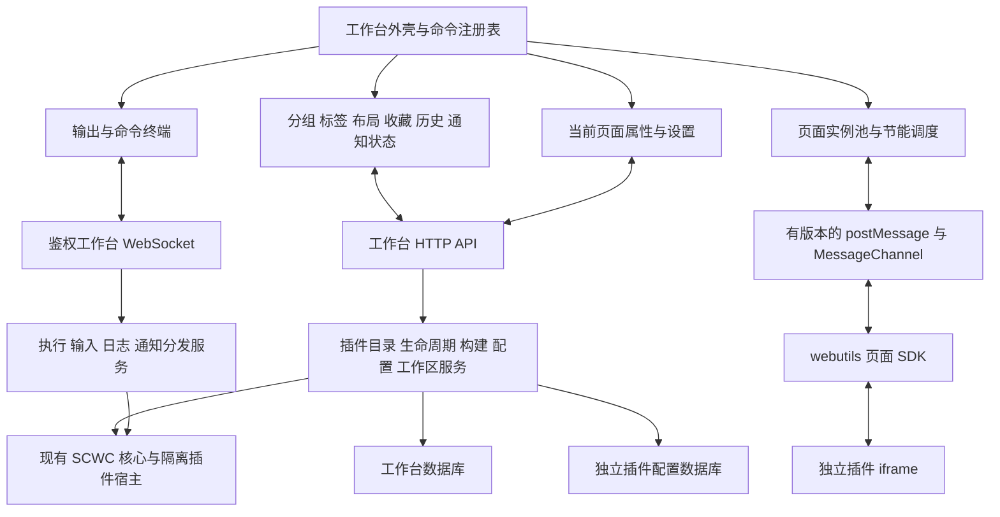

# Web 插件工作台设计方案

日期：2026-10-18。状态：待实施的功能与架构设计，依据当前源码核对。本文只约定区域位置、功能和交互，不规定组件尺寸、间距、字体、圆角、具体色值或视觉稿；Web UI 将单独设计。其中的 API、SDK 与界面尚未实现。

`/web` 定位为 SCWC 插件工作台：组织插件页面、管理插件运行状态、承载页面配置，并提供输出、命令终端和通知。插件业务界面继续由各插件提供。

配套文档：

- [技术契约与后端补充](Web插件工作台技术契约.md)：数据模型、API、通信、配置、命令执行、持久化与恢复。
- [上下文菜单改造与复制复用](Web上下文菜单复用设计.md)：先修改 sticker-management，再复制菜单实现的具体约定。

## 1. 设计结论与边界

| 决策 | 具体行为 |
| --- | --- |
| 延续现有技术体系 | 使用 Lit、TypeScript、CSS Variables、现有 Express、WebSocket、SQLite 能力；无需更换前端框架 |
| 工作台管理逻辑页面 | 一个标签是一个独立页面实例；同一插件可以打开不同 URL，也可以重复打开同一 URL |
| 页面入口与插件管理分视图 | 主侧栏默认“页面”，仅显示已确认提供 UI 的插件；“插件管理”显示全部检测到的插件，包含禁用、失败和无 UI 项 |
| 展示信息与插件标识分开 | 新增可选 `title`、`description`，并允许在 `package.json` 的 `scwc.ui` 配置；现有可选导出 `name` 继续表示插件标识 |
| 历史只记录关闭的插件标签 | 所有插件关闭记录进入同一个历史列表；导航、刷新、内置页面关闭及终端关闭不写入该列表 |
| 自动保存布局 | 持久保存侧栏、底部面板的位置、显隐与大小，以及中心分组树、分割方向和比例，刷新或重启后恢复 |
| 任意嵌套分组 | 中心使用可递归分割的分组树，每个叶子有独立标签栏；支持左右、上下拆分、跨组移动、同组内移动 |
| 固定与收藏独立 | 固定防误关闭；收藏保存一个可再次访问的具体 URL；两者都不自动保证页面永不休眠 |
| 当前页面驱动属性栏 | 属性栏跟随最近聚焦的插件标签，而非仅按 pluginId 查找；终端获得输入焦点时保留最近插件页面上下文 |
| 插件配置由后端保存 | 独立插件配置数据库；业务配置键和值均为字符串，使用点分键表达命名空间 |
| Web 终端独立存储 | 不读取、不迁移、不覆盖 `projects/terminal` 的状态文件；也不启动终端扩展宿主 |
| 节能分两层 | 协作暂停减少 CPU/网络；保存状态后卸载 iframe 才能释放页面运行资源，标签本身保留 |
| 明示浏览器限制 | 浏览器保留快捷键、页面截图、网络观测、iframe 原生历史都采用能力协商和明确降级 |

浏览器不会提供一个通用接口，让普通网页任意冻结一个 iframe 的 JS 堆、释放内存后再原样恢复。浏览器生命周期中的冻结与丢弃由浏览器决定；本设计的“休眠”是应用保存状态并卸载页面，不冒充浏览器原生冻结。[浏览器生命周期依据](https://developer.chrome.com/docs/web-platform/page-lifecycle-api)

## 2. 当前实现与需要补齐的能力

以下为源码观察；后续章节中的新接口均为拟新增。

| 当前事实 | 对设计的影响 | 源码依据 |
| --- | --- | --- |
| `content.ts` 只有一个 iframe，切换 `focusPluginPage` 修改其 URL | 需要拆开标签、分组与 iframe 实例的生命周期 | [content.ts](../projects/web/src/layouts/content.ts) |
| `/web/api/pages` 只读取已加载 `plugins`，仅返回 dir、pluginId | 无法直接完成禁用插件管理、版本展示与 UI 构建状态展示 | [api/index.ts](../projects/server/router/web/api/index.ts) |
| 已有 plugins、inactivePlugins、enablePlugin、disablePlugin、reloadPlugin 和 runtime PID/status | 复用生命周期服务，增加稳定的只读目录投影和 HTTP 操作入口 | [load.ts](../projects/server/plugin/load.ts)、[client.ts](../projects/server/plugin/process/client.ts) |
| 禁用插件在加载入口前返回；部分非法包只记录日志 | 不能为检测 UI 而导入禁用插件；完整目录清单需独立扫描并保留诊断项 | [load.ts](../projects/server/plugin/load.ts) |
| UI 缺失时当前启动流程会尝试构建，构建失败可导致插件加载失败 | 需将后端可用状态与 UI 准备状态拆开，见技术契约的迁移设计 | [build.ts](../projects/server/plugin/web/build.ts) |
| 构建支持去重、串行、取消、5 分钟期限；只接受受限的 `vite build` 声明 | Web 按钮应复用构建器，增加任务状态和订阅，不能执行任意 package 脚本 | [build.ts](../projects/server/plugin/web/build.ts)、[options.ts](../projects/server/plugin/web/options.ts) |
| 页面有 SPA 深链回退，但缺失资源的启发式依赖文件名是否含点；SDK 在 `</body>` 前注入 | 完整导航需要明确入口、资源和路由边界；SDK 引导需早于应用代码 | [page/index.ts](../projects/server/router/web/page/index.ts) |
| webutils 现有 fetch/resource/websocket；初始化消息不验证来源，父页面以 `*` 发送配置 | 扩展 SDK 前先建立有版本、带实例身份的握手，避免向任意接收者发送连接凭证 | [webutils](../projects/webUtils/lib/index.ts)、[content.ts](../projects/web/src/layouts/content.ts) |
| 插件类型的导出 `name` 可选，尚无插件级标题、描述字段；现有页面清单也没有展示元数据 | 新增可选字段与 package 静态配置，由目录投影统一计算标题和描述，避免用标识充当展示文案 | [plugin-env.d.ts](../projects/server/plugins/plugin-env.d.ts)、[protocol.ts](../projects/server/plugin/process/protocol.ts)、[api/index.ts](../projects/server/router/web/api/index.ts) |
| 终端通过父子进程 IPC 控制核心；日志 sink、输入 handler 和默认输出身份为单一全局状态 | Web 不能直接复刻 IPC 入口或再次覆盖这些单例；必须增加分发服务 | [ipc.ts](../projects/server/command/ipc.ts)、[log.ts](../projects/server/utils/log.ts) |
| `logger.toWeb` 位于采集请求的特定 logger 上，通过请求结果返回通知 | 保留其语义；工作台通知新增独立方法及事件路径 | [host.ts](../projects/server/plugin/process/host.ts)、[router/index.ts](../projects/server/router/index.ts) |
| 主题变量文件尚未从 Web 入口引入 | 先建设工作台主题 token 与加载链，再扩展主题选项 | [var.css](../projects/web/var.css)、[index.html](../projects/web/index.html) |

## 3. 总体架构



前端遵循单向状态更新：UI 派发命令，服务执行副作用，结果进入 Store，组件订阅自己需要的切片。DOM、iframe、MessagePort、AbortController、编辑器实例不进入可持久化状态。

建议目录：

```text
projects/web/src/
  app/                 启动、依赖注入、连接与恢复
  workbench/           外壳、活动栏、主侧栏、辅助侧栏、底部面板、底部状态栏、顶栏
  workspace/           分组树、标签、操作 reducer、布局校验
  pages/               iframe 池、导航、实例通信、休眠、快照
  plugins/             目录查询、运行状态、构建任务
  library/             收藏、关闭标签历史、搜索投影与页面搜索聚合
  commands/            命令注册表、快速访问、快捷键分派
  panels/              输出、命令终端、终端列表与输入编辑器
  settings/            工作台设置、独立快捷键设置页、插件配置统一编辑器（支持json5格式）
  notifications/       通知列表与短暂提示
  components/          新设计的基础组件；菜单按附加文档复制
  themes/              token、内置主题、主题导入校验
  transport/           HTTP、WebSocket、重试、事件顺序与版本
```

`projects/shared` 继续提供已有的连接配置等基础合同。新的工作台组件自己实现；除明确指定的上下文菜单外，不复制贴纸插件或终端的 UI 组件。可以抽取纯算法与协议类型，前提是不连带引入 TTY、Node 或终端插件依赖。

## 4. 区域位置与功能

### 4.1 默认桌面布局

布局由七个区构成：顶栏、活动栏、主侧栏、中心页面区、辅助侧栏、底部面板、状态栏。

| 区域 | 大致位置与功能 |
| --- | --- |
| 顶栏 | 页面顶部；左侧为尽量展开的主菜单，不显示 logo 或产品标题；中间为搜索/快速访问；右侧提供区域显隐操作 |
| 活动栏 | 默认位于主侧栏左侧，随主侧栏位置变化而变化；切换搜索、页面、收藏、历史、插件管理，底部提供设置与快捷键设置入口；主侧栏隐藏时仍可通过活动栏重新打开 |
| 主侧栏 | 默认在中心左侧；承载活动栏选定的视图、过滤排序及列表 |
| 中心页面区 | 工作台中部；承载可递归分割的页面组，每组有标签栏，内容为插件 iframe 或内置页面 |
| 辅助侧栏 | 默认在中心右侧；显示当前插件页面的属性、配置、运行与诊断信息 |
| 底部面板 | 默认在中心下方；一级只有“输出”“终端”，提供最大化、停靠、隐藏与上下文操作 |
| 状态栏 | 页面底部；显示页面所属插件、加载/请求状态、浏览器操作、URL 与通知入口 |

侧栏和底部面板支持调整大小、显隐及停靠位置；中心组间分割和主侧栏内部“打开的页面/插件列表”的分割也可调整。提供拖动与键盘操作、均分和恢复默认功能；空间不足时说明无法继续拆分的原因。实际组件尺寸和视觉表现由后续 UI 设计确定。运行、失败、休眠、固定与未保存状态需有可访问的说明，不能只依赖颜色识别。

### 4.2 顶栏与主菜单

左上角直接显示主菜单，不放 logo 或产品标题。空间允许时显示全部顶级菜单；不足时按原顺序保留前面的菜单，把末尾菜单逐项收入“…”并预留其所需空间。例如可从“页面、视图、布局、插件、工具、帮助”逐步变为“页面、视图、布局、…”，再变为“页面、视图、…”。当只剩两个顶级菜单加“…”且仍放不下时，直接把全部菜单收进“…”；不出现只保留一个顶级菜单加“…”的中间态。空间增加时按相反顺序恢复。

折叠依据菜单实际占用和顶栏可用空间，需适应本地化、字体缩放及窗口变化；不以固定屏宽断点替代。折叠不改变顺序、命令、快捷键或可用性，键盘仍能访问所有菜单。

中间搜索/快速访问用于搜索插件、标签、收藏、关闭历史与插件提供的内容，也支持输入 `>` 执行操作；可展示工作区上下文和当前平台快捷键提示。连接详情通过状态入口查看。

主菜单分为：

| 分组 | 操作 |
| --- | --- |
| 页面 | 打开页面、输入 URL、复制当前 URL、刷新、恢复关闭、关闭当前/其他 |
| 视图 | 主侧栏、辅助侧栏、底部面板、专注当前组、全屏 |
| 布局 | 左右拆分、上下拆分、均分、合并组、保存布局、应用布局、恢复默认 |
| 插件 | 打开插件管理、重新扫描目录、查看构建任务；重启/停止/临时停止作用于明确选中的插件 |
| 工具 | 新建命令终端、打开输出、通知中心、导出诊断 |
| 帮助 | 设置、快捷键设置、页面能力说明、连接设置、检查更新、关于 |

菜单中的操作、快捷键、命令面板共用 CommandRegistry，避免出现同名功能行为不一致。退出或重启整个核心不进入普通快捷操作；如以后加入，使用独立的生命周期控制流程并展示影响范围。

### 4.3 主侧栏

活动栏位于主侧栏左侧，依次提供搜索、页面、收藏、历史、插件管理，底部为设置和快捷键设置入口。主/辅助侧栏交换位置时，活动栏仍位于主侧栏左侧，职责不变。入口需有文字说明或可访问名称。

搜索框支持当前视图内过滤；搜索活动视图和顶栏搜索还可聚合标签、收藏、关闭历史及已接入的插件页面搜索结果，按 Enter 或“查看全部结果”在中心打开搜索页。页面搜索的异步与分页行为见第 5 节。工作台设置和快捷键设置各用自身搜索框，不纳入主侧栏内容过滤。

默认打开“页面”：分为可调节的上下两部分。上方为“打开的页面”，按中心分组列出标签，展示标题、页面类型和关闭操作；下方为已确认有 UI 的插件列表，同时显示其禁用/不可打开状态。页面 UI 为 unknown 的旧禁用插件只在“插件管理”出现，启用后更新探测结果。插件管理始终显示全部发现项，包括没有 UI 的后端插件和有诊断错误的包。

收藏页面：采用树状结构，支持文件夹、拖拽、重命名、删除、编辑名称和完整地址、打开；区分可打开、插件未启用、UI 缺失、UI 构建失败等状态。

历史页面：所有插件已关闭的标签统一列在一个列表中，可按关闭时间、插件或关键词过滤与恢复，不按插件另建历史库，详见第 6 节。

插件管理：显示插件卡片列表，按名称、运行状态、收藏优先、最近访问排序。支持 UI 状态、后端状态、收藏筛选。

插件条目显示解析后的标题、可选描述、UI 状态、版本、后端运行状态与操作入口。标题按“新增标题字段 → 导出 `name` → `package.json.name` → 插件文件夹名”降级；描述按“新增描述字段 → `package.json.description`”降级，都没有时不显示描述。新增字段可由导出 `title`/`description` 或 `package.json.scwc.ui.title`/`description` 提供；两处同时配置时导出字段优先，具体约定见技术契约第 2.2 节。标题可重复，不能替代插件标识。

所有有后端进程的插件都显示当前 PID，包括没有 UI 的插件；PID 来自后端运行事实，与 UI 状态无关。未知版本显示“未声明”，进程不存在时 PID 显示“—”，最后运行 PID 仅放诊断详情。

设置与快捷键设置：分别在中心打开独立内置页面，不在主侧栏中编辑。

| 后端/UI 状态 | 主按钮 | 下拉操作与说明 |
| --- | --- | --- |
| 禁用 | 启用 | 查看详情；已知 UI 可收藏入口、复制链接；启用过程中不可重复提交 |
| 启动中/停止中 | 状态文字、进度、加载动画 | 查看任务；仅在服务允许时取消 |
| 运行，UI ready | 打开页面 | 收藏入口、外部打开、重新构建 UI、重启、临时停止、停止 |
| 运行，UI missing，可构建 | 构建 UI | 查看构建日志、重启、临时停止、停止；构建成功切换为打开页面 |
| 构建中 | 构建中、加载动画 | 查看日志、取消构建；已有旧 UI 时可通过下拉打开旧版本 |
| 运行，无 UI | 停止 | 重启、临时停止、详情；不出现 UI 打开、构建或收藏页面按钮 |
| 声明 entry，但文件缺失且没有合法构建命令 | 停止，并显示警告 | 警告提示包含缺失入口与具体原因；若脚本存在但不受支持，分别说明 |
| 启动失败/宿主失败 | 重试启用/重启 | 查看错误、构建 UI（能力允许时）、禁用 |

“停止”定义为当前 `disablePlugin` 语义：停止后端并保存 `enabled=false`，界面提示“停止后下次启动也不会启用”。“重启”定义为 `reloadPlugin`，不重启核心。“临时停止”新增定义为 `onceDisablePlugin`，不修改 `enabled`，下次启动和重启核心仍会尝试启用。

启用动作默认“检测 UI → 必要时构建 → 更新状态”，但 UI 构建失败不应让本来可工作的后端永远不可启用。具体迁移见技术契约：启动时仍优先准备 UI，失败后保留后端启动机会并显式标记 UI 错误。

排序支持名称、运行状态、收藏优先、最近访问；支持升降序。筛选支持 UI 状态、后端状态、收藏。筛选有数量与清除入口，无结果时保留筛选条件。

点击“打开页面”时，聚焦当前组内已打开的同插件入口 URL（例如/web/page/plugin/sticker-management, 只会聚焦和这个路径完全一致的，如果插件页面在后面添加了新的路径、参数、哈希，则不会聚焦到这个页面）；Ctrl/Cmd+点击或下拉“作为新标签打开”强制创建新实例。中键打开新标签且不抢焦点。收藏页打开完整 URL，不能退回插件首页。

### 4.4 标签与分组

标签展示标题、未保存与加载/休眠状态，并提供关闭操作。标题优先级为：标签自定义名称 > 页面上报标题 > 按第 4.3 节降级规则解析的插件标题。原始标题单独保存，可查看原始名称、完整 URL 和插件版本。有未保存状态时，从标签、快捷键、主侧栏或批量操作触发关闭，都先执行一致的离开确认。关闭入口的具体样式由后续 UI 设计确定。

固定标签位于组内起始区；隐藏普通关闭入口，关闭快捷键、中键与批量关闭跳过它。显式“取消固定后关闭”可关闭。固定只防止工作台误操作，无法阻止用户关闭浏览器窗口。

标签右键菜单：刷新、重命名、恢复原始命名、固定/取消固定、收藏/编辑收藏、复制 URL、外部打开、复制为新标签、拆分到右侧/下方、移动到组、关闭、关闭其他、关闭左侧、关闭右侧、关闭本组未固定标签、休眠/唤醒、保持运行。不可用项展示禁用原因。

重命名输入 Enter 提交、Escape 取消，空白恢复自动标题，最长 100 字符。收藏自定义名称独立于标签名；收藏时初始带入标签自定义名称，后续修改互不隐式覆盖，提供明确的“同步到收藏名称”。

关闭规则：

1. 先计算范围，再排除固定标签；左/右指当前组内视觉顺序。
2. 有未保存状态时统一列出受影响页面，选择保留、由页面处理保存、或明确丢弃。
3. 确认后尝试获取状态及收藏预览，使用有界等待；截图失败不阻止已确认的关闭。
4. 仅对最终实际关闭的插件标签写入统一历史列表，保留关闭批次。恢复关闭的快捷操作从该列表选择最近尚未恢复的一批，尽量恢复原组与顺序；内置标签不进入历史。
5. 若原组已不存在，则恢复到当前组；容量不足时提供选择，不无声丢弃。

分组采用二叉 Split/Leaf 树，方向为 horizontal（左右）或 vertical（上下）。拖标签到组中心移动到该组，到边缘创建新组，到标签间隙重排。分组头支持拖动整组、均分、合并和最大化。拖动预览明确显示移动/复制；按 Alt/Option 拖动为复制页面实例。

关闭空组自动折叠树；最后一组保留欢迎页。最大化组是临时视图状态，不破坏保存的布局。移动活跃标签时，焦点和右侧属性跟随；移动后台标签不抢焦点。跨组移动优先保持 iframe 所在 DOM 不变，详见实例池设计。

工作台内置欢迎、设置、快捷键设置、搜索、收藏、历史、插件管理也可以作为中心标签打开，使用 `kind=internal`，不创建 iframe。它们与插件页面共用标签与分组操作，但禁用插件专有的导航、属性、休眠操作，关闭时不生成历史记录。

### 4.5 当前页面属性栏

属性栏顶部标明当前页面、所属分组与实例身份，下面包含概览、页面属性、配置与诊断：

- 概览：插件名、版本、当前 URL、原始/自定义标题、运行 PID、后端/UI 状态、桥接能力、固定/收藏/节能状态。
- 页面属性：获取由当前页面实例动态注册的只读信息，显示获取时间；限制为文本、数值、状态徽标和受校验的链接，不接受任意 HTML。
- 配置：获取由当前页面实例提供的配置信息，按页面声明分组，先尝试从插件配置数据库读取值，没有时新增默认值或NULL到数据库，支持用主侧栏搜索框过滤键、名称、说明；支持编辑、保存、单项/分组重置、查看原始字符串、默认值与来源。
- 诊断：页面加载事件、SDK 连接情况、已观测请求、构建任务、最近错误与输出定位。

配置显示“插件共享”“当前资源”“本标签实例”作用域。切换标签不丢弃编辑草稿，草稿按实例与配置键保存；共享配置发生外部更新时进行逐键冲突提示，不覆盖正在输入的值。

失焦页面晚到的注册消息更新自己的缓存，不得切换当前属性栏。休眠页面显示缓存属性和“页面已休眠”；声明式配置仍可编辑，需要页面回调的配置只读并提供唤醒。插件停止时保留最后可用的诊断信息并标记过期。

### 4.6 底部状态栏与浏览器操作

默认排列：`连接状态 | 插件/分组 | 加载与请求 | 后退 前进 刷新/停止 | URL 输入框 | 收藏 | 通知`。

浏览器控件始终针对 `focusedPluginTabId`。底部输入编辑器获得键盘焦点时，状态栏继续对应最近的插件标签；内置设置页激活时，浏览器控件显示不适用，避免误操作之前的页面。

| 页面状态 | 后退/前进 | 刷新/停止 | URL 与反馈 |
| --- | --- | --- | --- |
| 等待首次加载/导航中 | 无可用历史时禁用；有历史时可请求跳转 | 显示停止；失去控制能力时注明受限 | 展示待跳转地址，提交后显示校验与加载状态 |
| 已就绪 | 按工作台导航栈游标启用 | 显示刷新 | 展示已确认地址；Esc 恢复输入前值 |
| 有后台请求 | 同上 | 导航完成后仍是刷新 | 另显示“请求 N”，点击查看已观测请求 |
| 已休眠 | 按保存导航栈启用，操作会唤醒 | 显示唤醒/重新加载 | 保留原 URL，不伪装成仍在联网 |
| 插件停止/失效 | 不执行页面导航 | 显示启用或错误修复入口 | 地址可复制，原标签及历史保留 |
| 旧页面桥接不可用 | 只对已记录地址提供导航 | 可重新加载；停止若不可控则禁用 | 标记“兼容模式：页面状态不可完整观测” |

URL 可输入完整同源插件页面地址、合法插件路径或当前插件内相对地址。先解析再查询所属插件。跨插件跳转前执行当前页面离开检查，随后更换实例文档代次、清理旧属性和旧授权；不能继续使用旧插件的配置身份。外部 HTTP(S) 地址提供浏览器外部打开；`javascript:`、`data:` 等不作为插件页挂载。

URL 编辑态不被页面上报覆盖，显示“页面已导航”提示，提交/取消后再对齐。复制使用当前已确认地址，不使用未提交的草稿。外部打开在用户点击时同步触发；浏览器可能选择新标签或窗口，弹窗受阻时显示普通链接供再次点击。

`iframe.load` 不等于业务页面加载成功，浏览器甚至可能在失败时仍触发它。成功状态以 SDK ready、明确错误页标记及当前代次确认综合判断。[iframe 事件依据](https://developer.mozilla.org/en-US/docs/Web/HTML/Reference/Elements/iframe#error_and_load_event_behavior)

### 4.7 输出与命令终端

一级只有“输出”和“终端”。终端内部右侧边栏显示各终端标签的名称、运行/等待输入状态、未读数，支持新建、重命名、切换、停止、关闭、清空和导出。只有一个终端时可隐藏终端列表，停止终端按钮放在底部面板标签栏右侧的操作区，作用于该终端；存在多个终端时，停止按钮移到终端页内部右侧边栏的各终端标签右侧，作用于该条目。数量变化时自动切换位置，操作目标始终由 terminalId 绑定；新建终端入口始终可用。

停止终端指取消该终端当前执行或等待输入，保留终端、草稿与输出；空闲时该操作不可用。关闭终端、清空输出、隐藏底部面板分别是独立操作，协作取消失败时才进入明确的强停流程。

输出页接收核心公共日志、插件生命周期/构建日志与明确的工作台诊断；支持级别、插件、来源、关键词筛选，暂停跟随、时间戳、自动换行、复制选择和导出。关闭底部面板或切换一级标签不会清空输出，也不停止接收及持久化。

这里的终端是 **SCWC 命令控制台**，使用现有核心命令与核心业务插件命令，不是操作系统 shell，不使用 PTY，也不支持终端插件。没有冒号全局命令模式；新建/关闭/清空等操作放到 UI 和命令面板。

输入支持原生文本选择、IME、多行、历史草稿、上下键历史、动态补全和按调用请求的 `next` 输入。建议用现有 CodeMirror 依赖建设专用输入编辑器，输出由独立虚拟列表渲染。上/下键在多行首/末行越界时切换历史，其余情况移动光标；回到历史末项恢复草稿。Enter 提交、Shift+Enter 换行。Tab 打开或接受补全，不承担切换终端功能。

Ctrl+C 有选区时复制；无选区且命令运行时协作取消；Cmd+C 固定用于复制；等待 `next` 时取消本次输入。普通编辑快捷键以平台习惯为准。本阶段不加入 CMD 中无法传递的额外编辑组合键。工作台标签快捷键不在输入编辑器内部无条件抢占。

每个终端只运行一个顶层命令，不同终端可并发。函数 returned 与任务 finished 分开显示；等待输入、后台任务、取消中都占用该终端。关闭忙终端先要求选择取消并关闭或保留；隐藏面板始终不取消任务。核心重启后恢复终端、历史、草稿和输出，把未完成执行标为中断，不自动重跑。

### 4.8 设置、快捷键设置与布局恢复

设置作为中心内置页，不在主侧栏中显示，分类包括外观、布局、页面行为、节能、终端与输出、通知、数据、连接、插件配置，并提供“打开快捷键设置”入口。设置可搜索，展示默认值与修改标记，支持单项及分类重置。

设置和快捷键设置分别在当前工作区内复用唯一内置标签：已打开时聚焦其所在分组，否则在当前组打开。

设置页面顶部有“搜索设置”输入框，支持按键、名称、说明搜索。搜索结果按分类分组，点击结果聚焦到对应设置项。
设置页面的内容不接入主侧栏的搜索过滤，搜索结果只在设置页面内显示；搜索命中“快捷键设置”入口时可跳转到独立快捷键设置页。

快捷键设置页集中显示所有可配置快捷键项，包括主页面的搜索、菜单、活动栏、区域显隐、标签、分组、导航、面板和终端操作，以及尚未绑定按键的命令。支持按名称、命令 ID、说明、按键和作用域搜索，录入/修改/移除绑定，查看默认值、修改标记及冲突，逐项或全部重置。平台与输入上下文分开管理；修改后立即应用并持久保存，菜单、提示与快捷键分派读取同一份有效绑定。浏览器限制见第 5 节。

| 分类 | 配置项 |
| --- | --- |
| 外观 | 跟随系统、2026 浅色、2026 深色；缩放、减少动画和主题导入 |
| 布局 | 主侧栏在左/右（辅助侧栏随之交换）；组内标签栏上/下/左/右；面板下/左/右；面板对齐中心或全宽；区块显隐与尺寸 |
| 页面 | 重复打开策略、启动恢复方式、关闭后焦点 MRU/相邻、固定标签展示、未保存提示 |
| 节能 | 关闭/平衡/节省；协作暂停延时、休眠延时、热实例预算；按插件例外；保持运行列表 |
| 快捷键设置入口 | 在中心打开独立快捷键设置页；搜索、修改、移除与重置全部可配置绑定 |
| 数据 | 历史与输出保留期限、容量、快照开关、清理、导入/导出、恢复备份 |
| 通知 | 来源/级别筛选、静默、短暂提示开关、未读与保留策略 |

主侧栏与辅助侧栏的“主/辅助”是逻辑身份，不能因为交换左右就交换职责。标签纵向布局占用各组内部区域，不复用主侧栏。底部面板停靠侧面时仍保留输出/终端的内部结构。

整体配色方向参考 VS Code 的 **Light 2026 / Dark 2026**，内置主题命名为“2026 浅色”“2026 深色”，默认跟随系统；不再沿用仅深色、紫色主调的旧稿。这里仅确定主题方向，具体色值和控件样式留待 UI 设计。[VS Code 2026 主题参考](https://code.visualstudio.com/blogs/2026/10/15/modern-ui)

主题通过背景、表面、文字、边界、强调与焦点等语义 token 向 Shadow DOM 继承，菜单、面板、终端与内置页共同适配。自定义主题导入只接受白名单数据，不执行任意 CSS。插件页面通过 SDK 获取主题模式和少量 token；是否应用由插件选择，不能依靠父页面 CSS 穿透 iframe。

布局预设建议：默认、双页对照、专注、监控。用户可保存命名布局；“保存布局”仅保存区域和分组结构，“保存工作区”另包含标签与 URL，避免应用布局意外打开大量页面。

日常调整自动持久化，不要求用户手动保存预设。保存主/辅助侧栏的位置、显隐、大小、当前视图和内部划分，底部面板的停靠、对齐、显隐、大小及当前页，中心区域的完整分组树、分割方向与比例和标签栏位置。隐藏后再打开、浏览器刷新、重连和核心重启都恢复最近成功保存的布局；窗口变小产生的临时折叠或尺寸约束不覆盖用户保存值。写入失败显示未保存状态，具体结构与恢复规则见技术契约第 1.2、10 节。

### 4.9 小屏、无障碍与异常状态

空间不足时逐步折叠辅助侧栏、将主侧栏临时收起，必要时一次展示一个分组并提供组切换入口；保留原分组树和用户保存的尺寸。顶栏菜单按第 4.2 节的可用空间规则折叠。具体断点与呈现样式由后续 UI 设计确定。窄屏仍可使用导航、地址编辑与通知。

所有图标按钮有可访问名称；标签与终端列表使用 roving tabindex，菜单支持方向键、Enter、Escape，关闭弹层恢复触发按钮焦点。拖拽同时提供“移动到分组”“移动到前/后”等键盘操作。焦点环可见，尊重 reduced-motion；通知正文以纯文本渲染。

主要异常页要提供下一步操作：首次连接失败、鉴权失效、插件停止、构建失败、SDK 超时、URL 无归属、快照不兼容、存储写入失败。存储失败时明确“尚未保存”，继续在内存工作且提供导出；不能显示虚假的保存成功。

## 5. 快速访问与快捷键

快速访问是查找与操作的统一入口，默认无前缀混合搜索。宿主索引包含解析后的插件标题/描述、插件标识、页面标题、标签自定义名称、URL、收藏名称和关闭历史标题；按匹配强度、已打开、收藏、最近关闭等信息排序。插件页面返回的业务结果单独标明插件及来源标签，不把不同来源的相关性分数直接混排。

webutils 新增可选 `scwcutils.search.register`，由插件页面注册异步搜索函数。主页面搜索栏提交关键词后，宿主通过实例桥接调用已连接且注册了该能力的页面，把结果返回到主侧栏搜索视图或中心搜索页展示。默认搜索这些在线来源，也允许缩小到当前页面；同一插件的不同标签是不同来源。未接入的插件仍可按元数据检索；搜索不会为了调用函数而创建或自动唤醒休眠页面。

每个页面来源独立维护分页游标，支持首批结果、加载更多、加载中、无结果、失败与重试；一个来源失败不阻断其他来源。关键词改变或来源页面导航/关闭时取消旧请求并丢弃迟到结果，不能混入新搜索。插件函数接收关键词、分页游标、批量大小和取消信号，异步返回结果与下一页游标；函数留在插件页面内，宿主只交换可序列化数据。完整接口与边界见技术契约第 4.4 节。设置及快捷键设置继续使用自己的搜索入口。

| 输入方式 | 功能 | 示例 |
| --- | --- | --- |
| 无前缀 | 找插件、已打开标签、收藏、关闭历史与已接入插件的内容 | `贴纸 收件箱` |
| `>` | 执行工作台操作 | `> 向右拆分`、`> 新建终端`、`> 清理历史` |
| `@` | 仅查已打开标签与分组 | `@ 待整理` |
| `*` | 仅查收藏 | `* 动图` |
| `#` | 仅搜索关闭标签历史 | `# 昨天` |
| 完整 URL/插件路径 | 跳转或打开插件页 | `/web/page/plugin/sticker-management/...` |

命令分组：页面（打开/刷新/固定/收藏/休眠/恢复）、布局（拆分/移动/均分/专注/应用预设）、插件（启用/构建/重启/停止/查看日志）、面板（输出/终端/通知）、设置（主题/快捷键/数据）。危险或多目标操作先进入目标选择与影响摘要，不从模糊搜索结果直接执行。

结果支持 Enter 打开/执行、Ctrl/Cmd+Enter 作为新标签、Alt/Option+Enter 在右侧新组打开；如果组合键被浏览器保留，结果旁的按钮提供相同行为。`>` 不解释为服务器命令；不执行任意 shell 或插件传来的函数。

| 请求的操作 | 偏好的组合键 | 普通浏览器的建议可配置替代 |
| --- | --- | --- |
| 快速访问/命令 | Ctrl/Cmd+Shift+P | F1 或点击顶栏；Firefox 可能保留前者 |
| 切换工作台标签 | Ctrl+Tab / Ctrl+Shift+Tab | Alt+J / Alt+K（macOS 可设 Ctrl+J / Ctrl+K） |
| 关闭工作台标签 | Ctrl/Cmd+W | Alt+W（macOS 可设 Ctrl+W） |
| 恢复关闭的工作台标签 | Ctrl/Cmd+Shift+T | Alt+Shift+T（macOS 可设 Ctrl+Shift+T） |
| 刷新当前插件页 | 可配置 | Alt+R 或状态栏按钮，避免 F5 刷新整个工作台 |
| 聚焦工作台地址 | 可配置 | Alt+L 或点击状态栏，避免 Ctrl/Cmd+L 抢浏览器地址栏 |
| 主侧栏 | Ctrl/Cmd+B | 命令面板可改键 |
| 显示面板 | Ctrl+反引号 | 工具栏与命令面板同时可用 |

**不能保证 Ctrl+Tab、Ctrl+W、Ctrl+Shift+T 能被普通网页接管。** 默认 Web 配置不依赖这些保留键：显示请求键的兼容说明，启用可重绑定的替代操作；未来桌面壳可单独提供原生键位。VS Code Web 也记录了关闭编辑器及 Firefox 命令面板键的浏览器限制。[官方说明](https://code.visualstudio.com/docs/remote/vscode-web#_keyboard-shortcuts)

快捷键分派按弹层 > 输入编辑器 > 页面 > 工作台范围处理；使用 `isComposing` 和输入目标检测，不破坏 IME。iframe 内事件不会冒泡到父文档，需要 SDK 转发已允许且可取消的按键，不能在父页面收到消息后再取消已发生的浏览器行为。独立快捷键设置页列出全部可配置项及有效上下文，提供冲突提示、平台配置、修改与重置，详见第 4.8 节及技术契约第 1.4 节。

## 6. 收藏与统一关闭历史

收藏是一条持久化页面定位记录，字段包含插件稳定标识、原始插件/页面名称、自定义名称、收藏时间、完整 URL（path/query/hash）、最近访问、备注/标签与快照引用。查询参数不排序、不合并重复键；hash 参与页面定位。工作台传输用的临时授权不写入 URL，也不进入收藏。

收藏去重默认按安装实例、插件及精确业务 URL；同 URL 再收藏进入编辑，可显式“另存一份”。插件首页收藏与深链收藏可以同时存在。插件移除或目录变化时保留条目并标记不可用，用户可重绑定，不自动按相似名字打开其他插件。

历史记录仅在某个插件页面的逻辑标签被实际关闭后产生。每条记录保存关闭时的标题、完整 URL、插件标识、关闭时间、原工作区/分组、顺序、可恢复状态与批次；同一 URL 的不同标签分别保留。导航、刷新、激活、休眠、插件停止但标签保留、取消关闭，以及设置/快捷键设置等内置页或终端关闭，都不新增记录。浏览器窗口关闭或刷新后要恢复的逻辑标签也不视为已关闭。

所有插件关闭记录按 profile 汇总到同一个历史列表，默认按关闭时间倒序；插件仅作为过滤条件，跨工作区记录也进入同一列表。支持按时间、插件、标题、URL 搜索，单条/批次恢复、删除、范围清理与清空。默认保留 90 天/10000 条，可在设置中调整；不再另设浏览访问历史或第二份“最近关闭”列表。“恢复关闭”直接读取这个列表，恢复本身不新增记录；原组不存在或属于另一工作区时恢复到当前组。

每个标签内部的后退/前进导航栈只服务该标签，不写入全局历史。最近聚焦时间、收藏最近打开时间可用于排序，也不生成历史条目。删除记录同步移除搜索投影和无其他引用的预览；终端归档使用独立入口。

关闭页面时的截图采用尽力获取，具体能力与失败情况见技术契约。收藏 URL A 导航到 B 后关闭，不可把 B 的预览错误标记成 A；B 的截图归本次关闭记录，A 保留自己的最近预览并显示实际截图时间。快照不是业务状态，不用于恢复 JS 堆。

## 7. 页面性能与资源控制

### 7.1 状态与策略

| 状态 | iframe | 资源行为 | 切回体验 |
| --- | --- | --- | --- |
| visible | 存在并可见 | 各组当前页正常运行；只有一个获得输入焦点 | 直接使用 |
| background | 存在，隐藏 | 显式通知 SDK 不可见；短期保留 | 直接使用 |
| suspended | 存在，隐藏 | 插件暂停轮询/动画，停止非必要订阅，释放可重建缓存 | resume 后恢复；DOM 与 JS 堆仍在 |
| hibernating | 正在保存 | 离开检查、获取带版本状态，持久化成功后才能卸载 | 用户切回会取消或完成当前转换 |
| hibernated | 不存在 | 保存标签与状态，释放该文档资源及宿主持有的引用 | 重建 iframe，握手，恢复状态与配置 |
| restoring | 正在创建/恢复 | 每次分配新文档代次，拒绝旧消息 | 先显示预览和恢复进度 |

CSS 隐藏 iframe 不会自动改变其中 document 的可见性，因此必须发送工作台自己的 visibility 消息。不能把 `display:none` 当成节能协议。[Page Visibility 依据](https://developer.mozilla.org/en-US/docs/Web/API/Page_Visibility_API)

平衡模式初始建议：后台 30 秒协作暂停；后台 10 分钟且状态可恢复时休眠；热实例预算为“所有可见页 + 3 个最近后台页”，只作为调度目标，允许保护项超出。节省模式建议 10 秒/2 分钟/额外 1 页。先通过测试插件测量，再固化默认值，不把参数当作实测性能结论。

以下页面不自动休眠：可见页、未保存且未形成可恢复草稿的页面、上传/下载或需保活交互中的页面、声明保持运行的页面、尚未支持状态恢复的旧页面。固定标签默认仍可休眠，可单独勾选“保持运行”。播放音频、后端长任务和页面上传分别报告，不能仅凭“存在网络请求”判断。

插件未接入恢复协议时默认只保留/协作暂停；用户可显式选择“释放页面，下次重新加载”，告知可能丢失状态。任何自动策略都不靠浏览器堆内存估算来承诺每页内存值；资源面板主要展示实例数量、状态、请求与任务，精确内存诊断作为可选实验能力。

### 7.2 实例池与渲染成本

`FramePool` 保持一个稳定容器与不随标签排序改变的实例插入顺序；标签列表只是实例引用。通过各组页面区域的矩形定位该组活跃 iframe，后台 iframe 保留在原容器且隐藏。移动标签只改变所属组与可见矩形，不在不同 DOM 父节点间重新挂载 iframe。

DOM 重挂 iframe 可能导致重新加载，不能以 Lit keyed render 自动保证跨父节点移动保活。拆分调节和拖拽期间增加临时覆盖层，避免 iframe 抢走 pointer；结束时恢复输入与焦点。ResizeObserver 更新矩形，合并到 requestAnimationFrame，后台实例不重复计算布局。

大列表、输出、历史采用虚拟化与分页；网络状态合并更新，日志按批次进入前端 Store，滚动与存储不逐字符重渲染。主题和右侧配置只更新相关切片。启动时先恢复布局和轻量标签，优先创建可见 iframe，后台标签按需恢复，避免一次加载所有收藏或历史页面。

逻辑标签与热 iframe 分开设上限。建议标签软上限 100、硬上限 200，分组软上限 8；达到软上限提示整理，不静默关闭页面。实例热预算不等于标签上限；状态与截图另有独立容量上限。

### 7.3 恢复的承诺

可恢复范围由插件声明：当前 URL、滚动位置、筛选、选中项、分页、编辑草稿等 JSON 状态。不能通用恢复打开的文件句柄、任意第三方组件的内部状态、正在进行的 fetch、音视频解码上下文或闭包。后端长任务应使用可查询的 taskId，恢复后重新订阅，不能重新执行任务。

休眠流程、超时、文档代次、配置追平和版本迁移详见技术契约。性能验收分别测量协作暂停的 CPU/网络下降、卸载后的文档/监听引用释放和恢复正确性，不承诺固定比例的 RSS 下降。

## 8. 通知中心

通知来源分工作台、核心、插件后端、插件页面，统一存储为有 ID 的记录。右下角铃铛显示未读数，点击在其上方打开列表；未读、全部、错误与来源筛选，支持标记已读、清除、定位关联标签/输出/任务。

插件后端新增 `logger.workbench.info/warn/error/success`，页面新增 `scwcutils.logger` 对应方法；它们不替换现有 info/error 输出，也不改变 `logger.toWeb`。后端通知在没有工作台连接时仍入库，页面通知经宿主确认后入库。普通日志默认不全部变成通知，避免输出洪流污染通知中心。

相同来源与 dedupeKey 的重复通知合并计数，保存最近时间。级别、来源、正文、动作和目标均受协议约束；动作是登记过的命令 ID 或合法插件 URL，不接受可执行 JS。休眠页可收到相关后端通知，但不因每条通知自动唤醒。

## 9. 实施顺序与验收门槛

各阶段完成可独立验证的纵向能力，最终目标包含全部需求；阶段划分不删减范围。

| 阶段 | 交付 | 必须通过的验收 |
| --- | --- | --- |
| A：合同与基础 | 目录投影、稳定身份、实例握手、独立数据库、主题 token、菜单源改造后复制 | 禁用插件无执行；来源校验；菜单点击外部默认关闭；配置字符串存储 |
| B：工作台与导航 | 七区布局、活动栏、自适应菜单、多标签、分组树、实例池、URL 导航、固定 | 同插件双实例独立；跨组移动不重载；布局自动恢复；批量关闭保护固定/脏页 |
| C：页面查找与管理 | 收藏、统一关闭历史、预览、异步分页页面搜索、布局设置、独立快捷键设置 | 历史仅记录关闭的插件标签；query/hash 完整；旧搜索拒收；浏览器保留键有替代 |
| D：配置与通知 | 动态属性、配置注册/双向更新/CAS/重置、通知 SDK 与后端 logger | 焦点切换无串页；两窗口冲突可见；旧代次拒收；通知不混入 toWeb |
| E：Web 命令面板 | 分发服务、HTTP/WS 适配、输出、多终端、输入与持久化 | CLI 与 Web 同时使用；next 不串窗；重连不重放命令；不加载终端存档/扩展 |
| F：资源与恢复 | 协作暂停、状态快照、休眠/唤醒、容量策略、无障碍与兼容测试 | 保存失败不卸载；脏页保护；版本不兼容不丢状态；无无界日志/快照增长 |

建议先实现可测试的协议与状态 reducer，再接 UI。A/B 可并行准备样式和界面，但不能绕过身份、持久化与执行归属合同。上下文菜单必须先在原插件完成改造和验证，再复制至工作台。

## 10. 需求对照

| 原需求 | 本方案位置 | 关键验收点 |
| --- | --- | --- |
| 1 加载、多标签、分割 | 3、4.3、4.4、7.2 | 页面视图只显示已确认 UI，跨组移动保留实例 |
| 2 标签管理与右键菜单 | 4.4、菜单附加文档 | 排序、关闭范围、复制 URL、重命名和外部打开一致 |
| 3 常驻固定 | 4.4、7.1 | 批量/快捷键不误关；保活可单独设置 |
| 4 收藏与截图 | 6、技术契约快照节 | 完整 URL、原始/自定义名、收藏时间、关闭预览及失败降级 |
| 5 历史 | 6 | 只在实际关闭插件标签时记录，全部进入同一列表，可搜索、恢复与删除 |
| 6 快捷键 | 4.8、5、技术契约 1.4 | 中心独立设置页、全部可配置项、搜索/修改/重置、浏览器限制与替代 |
| 7 设置与布局 | 4.1、4.8 | 2026 浅/深主题方向、区域位置与大小和中心分割自动持久恢复 |
| 8 输出、多终端 | 4.7、技术契约执行节 | 单终端/多终端停止按钮切换、独立持久化、输入历史、无终端扩展/全局模式 |
| 9 主侧栏 | 4.1、4.3 | 主侧栏左侧活动栏、搜索与页面列表、管理视图 |
| 10 属性与配置 | 4.5、技术契约配置节 | 当前实例绑定、动态注册、扁平字符串 KV、双向更新 |
| 11 搜索 | 4.3、5、技术契约 4.4 | 元数据与关闭历史检索、页面可选异步函数、独立分页/取消/迟到结果隔离 |
| 12 全插件管理 | 2、4.3、技术契约目录节 | 标题/描述降级与 package 配置、无 UI 插件 PID、禁用项与启用/构建/打开链 |
| 13 快速访问 | 5 | 多来源搜索、命令上下文、可发现的操作 |
| 14 浏览器能力 | 4.6、技术契约导航节 | 独立导航栈、URL 归属、加载状态与禁用条件 |
| 15 状态栏与通知 | 4.6、8 | 请求观测范围明确，前后端通知可汇集 |
| 16 顶栏 | 4.2 | 左上角无 logo/标题、按空间渐进折叠菜单、搜索与区域显隐 |
| 17 菜单复制复用 | 菜单附加文档 | 源修复→验收→复制，其他组件重新设计 |
| 资源与内存问题 | 7、技术契约休眠节 | 协作暂停和保存卸载分开，不承诺任意 iframe 原生冻结 |
