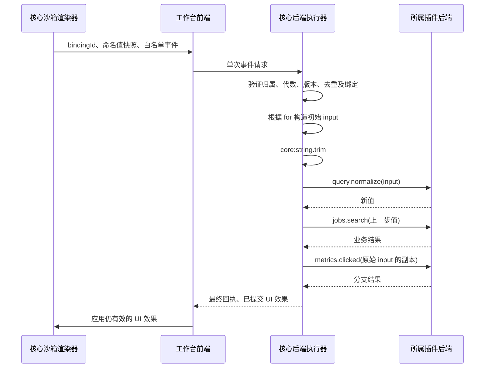

# 插件声明式 UI、当前页面与后端事件管道设计

状态：待用户审核，未实施。本文整合本轮及上一轮要求；与上一轮回答冲突的内容以本文为准。源码核查日期：2026-10-28。

## 1. 目标与范围

插件后端注册 UI、静态资源、事件与管道处理器；核心负责校验、内容编译、实例归属、事件调度和资源服务；工作台前端负责受限渲染、原始交互采集及核心 UI 效果执行。

| 区域 | 数量限制 | 内容 |
| --- | --- | --- |
| 主侧边栏 | 每插件最多一个自定义页 | JSON 或 HTML；活动栏增加入口 |
| 辅助侧边栏 | 每插件最多一个自定义页；工作台当前最多一个自定义页 | 与内置“当前页面”合计最多两个页签 |
| 底部状态栏 | 每插件最多一个状态项 | 专用 JSON 配置、资源图标或核心预设图标 |
| 状态项提示层 | 每状态项一个 | 文本、JSON 或 HTML；可点击聚焦固定 |
| 状态项右键菜单 | 每状态项一个 | 专用 JSON；条目共用事件管道 |

辅助侧栏不汇总所有插件的自定义页面。默认跟随中心当前插件标签选择所属插件；显式打开某插件辅助页时，可在当前窗口暂时选择该插件上下文，下一次中心标签切换恢复跟随。辅助栏始终只包含“当前页面”和该上下文插件的一个自定义页。

插件可在自己的辅助页定义中设置 `hideCurrentPage: true`，并在运行时修改。该设置只作用于当前显示该插件辅助页的上下文，不永久改变工作台全局偏好，也不能隐藏其他插件上下文的页面。隐藏后只显示自定义页；注销、停用、重载失败或插件不可用时恢复内置“当前页面”。没有自定义辅助页时不允许隐藏内置页。整个辅助栏仍可由用户折叠。

本轮只新增设计文档并维护明确的长期要求，不删除运行代码、不安装依赖。下文的删除清单在设计获准后的实施阶段执行。

## 2. “当前页面”源码核查结果

当前实现并非全部由后端提供。不能因为某个值最终经 HTTP 或数据库返回，就把原本由插件前端任意提供的数据认定为后端来源。

| 当前内容或能力 | 当前来源与代码证据 | 目标处理 |
| --- | --- | --- |
| 插件标题、说明、版本、PID、后端状态、UI 构建状态 | [catalog.ts](../projects/server/workbench/catalog.ts)、核心插件加载状态 | 保留，由核心后端投影提供 |
| 配置值、默认值、定义、双 revision | [page-inspector.ts](../projects/web/src/components/page-inspector.ts) 的 `load()` 请求后端；[plugin-config.ts](../projects/server/workbench/plugin-config.ts) 保存 | 值继续由后端保存；定义与校验只允许插件后端提供 |
| 插件属性 | webutils `page.register/update` 的 `properties` → [frames.ts](../projects/web/src/workbench/frames.ts) 的 `r.properties` → inspector | 删除前端注入通道；改为插件后端属性提供器 |
| 页面标题 | webutils 的注册、ready 或导航上报可影响标签标题，inspector 使用 `titleOf(tab)` | inspector 改读后端明确提供的标题；不借用 iframe 上报标题 |
| 页面状态、SDK 请求数、累计请求数、保活原因、编辑状态 | inspector 直接读取 `FramePool.runtimes`；部分值来自 iframe 消息 | 从“当前页面”移除；不能将 SDK 自报统计改名为后端统计 |
| 桥接、恢复、搜索能力与部分错误 | iframe 生命周期/搜索注册及前端 FrameRuntime | 从“当前页面”移除；后端确知的会话、进程错误另行展示并准确命名 |
| 配置定义注册与替换 | [webUtils/lib/workbench.ts](../projects/webUtils/lib/workbench.ts) 的 `settings.register()`，返回的 `update()` | 删除 SDK 接口、消息与对应页面授权写入口 |
| 配置修改与重置 | webutils 的 `config.set/reset` | 删除 SDK 写能力，并在服务端拒绝页面授权调用这些写入口 |
| 配置页面校验 | inspector 向 iframe 请求 `config.validate`；webutils 本地 normalize/validate 后申请票据 | 删除整条前端校验链，只保留声明式校验与插件后端校验 |

具体核查入口：

- [page-inspector.ts](../projects/web/src/components/page-inspector.ts)：`load/save/control/render`，当前同时依赖 `store`、`pool` 和 iframe 校验。
- [webUtils/lib/workbench.ts](../projects/webUtils/lib/workbench.ts)：`page.register/update`、`settings.register`、`config.set/reset`、`config.validate` 请求处理。
- [workbench-protocol.ts](../projects/shared/workbench-protocol.ts)：`PageRegistration` 含 `title/dirty/contextKey/properties/capabilities`。
- [frames.ts](../projects/web/src/workbench/frames.ts)：`page.update`、`requests.changed`、`activity.*`、`search.changed` 等消息处理。
- [工作台路由](../projects/server/router/web/workbench/index.ts)：`config/definitions`、`config/validation`、`config/update`、`config/reset`。
- [page-sessions.ts](../projects/server/workbench/page-sessions.ts)：当前对配置路径及其子路径整体放行；需改成按方法与路径的明确权限表。

### 2.1 删除与保留边界

实施时删除：

1. webutils 的公开 `page.register/update`，以及作为属性注入协议的 `PageRegistration`。
2. webutils 的 `settings.register` 及其 `update/dispose`，本地配置 normalize/validate 注册表、页面校验处理和票据申请。
3. webutils 的 `config.set/reset`。`config.get/subscribe` 可保留为当前插件的只读后端数据访问。
4. 父页面接收 `page.update.properties` 等 inspector 内容注入的逻辑，以及 inspector 对 FramePool 的读取和 `settings-changed` 订阅。
5. 页面授权下的配置定义注册、校验票据及配置写权限；仅删除 SDK 方法不足以关闭能力。
6. `page-required` 新定义及对应前端校验分支。旧数据采用后述显式迁移，不静默降级校验。

webutils 的导航、关闭保护、暂停恢复、搜索、活动和请求生命周期机制可以继续服务其原有功能，但这些浏览器状态不再成为“当前页面”的展示数据。若删除 `page.update.dirty` 影响关闭保护，需改用现有 `lifecycle.canLeave`/快照保护流程验证行为，不以新的 inspector 元数据通道恢复它。普通中心标签的导航显示与 inspector 的后端投影分开。

普通插件页面目前处在受信的同源环境。本次删除保证 SDK、协议及受限授权接口不再提供该能力，不把它宣称为对受信插件任意浏览器代码的完整隔离。

### 2.2 新的后端投影

新增 `GET /web/api/workbench/inspector?workspaceId=...&tabId=...`。核心核验窗口、工作区、标签归属，再汇总自身状态和所属插件后端提供器；返回单一版本化快照。

```ts
interface InspectorSnapshot {
  version: 1;
  pluginId: string | null;
  tabId: string;
  coreBootId: string;
  ownerEpoch: string | null;
  revision: number;
  generatedAt: string;
  page: {
    title: string;
    entryUrl: string | null;
    // URL 为核心解析的入口/受理目标，不声称是 iframe 实时地址。
  };
  plugin: {
    title: string;
    description: string | null;
    version: string | null;
    pid: number | null;
    runtimeStatus: string;
    uiBuildStatus: string;
  } | null;
  properties: { key: string; label: string; value: string }[];
  config: ConfigSnapshot;
  diagnostics: { code: string; message: string; source: "core" | "plugin-backend" }[];
}
```

标题优先为核心保存的用户自定义标题，其次为插件后端提供的页面标题、后端插件标题。不能从 `document.title` 或由 iframe 导航上报写入的旧字段回填。后端不能确知的页面状态留空或不显示，不能伪造“休眠”“有未保存更改”等结论。

插件可通过 `ui.inspector.register({ provide(context) })` 注册一个只读属性提供器，提供当前资源的标题和键值属性。上下文由核心绑定，只包含所属插件、窗口、工作区、标签和核心解析的页面定位。提供器不能替换核心 PID、版本、进程状态，不能提供前端校验器或 HTML。`invalidate({ tabId? })` 通知核心重新取数，`dispose()` 注销。

配置定义继续由插件后端的 `configuration.definitions/normalize/validate/onChange` 提供。内置配置编辑器仍可让用户编辑草稿，但保存、重置和所有权威校验都在核心/插件后端完成。网页草稿和按钮状态属于前端交互状态，不属于权威展示数据。

## 3. 后端公开接口

以下为拟新增契约。`context.workbench.ui` 随所属插件进程注入，插件可以长期持有。普通插件页面的 `handler.ui` 继续承担原有页面入口；仅注册新侧栏/状态项不要求额外提供中心 HTML 入口。

```ts
type JsonValue = null | boolean | number | string | JsonValue[]
  | { [key: string]: JsonValue };
type EventProgram = string;
type FieldValue = string | boolean | string[];

interface Disposable { dispose(): Promise<void> }
interface PluginUI {
  apis: {
    mountStatic(
      path: string,
      source: { file: string } | { directory: string },
    ): Promise<Disposable>;
  };
  handlers: {
    register(name: string, definition: HandlerDefinition): Promise<Disposable>;
    alias(name: string, preset: CoreHandlerPreset): Promise<Disposable>;
  };
  registerMainSidebar(def: SidebarDefinition): Promise<SidebarHandle>;
  registerAuxiliarySidebar(def: AuxiliaryDefinition): Promise<AuxiliaryHandle>;
  registerStatusBar(def: StatusBarDefinition): Promise<StatusBarHandle>;
  inspector: {
    register(def: InspectorProvider): Promise<InspectorHandle>;
  };
}

interface HandlerDefinition {
  kind: "event" | "pipe";
  reads?: string[]; // 额外允许采集的当前实例命名值
  run(input: JsonValue, context: HandlerContext):
    JsonValue | void | Promise<JsonValue | void>;
}
interface CoreHandlerPreset {
  handler: `core:${string}`;
  args?: { [key: string]: JsonValue };
}
interface HandlerContext {
  eventId: string;
  instanceId: string;
  windowId: string;
  workspaceId: string;
  source: { kind: UISurface; viewId: string; name?: string };
  event: NormalizedUIEvent;
  initialInput: JsonValue;
  // 仅访问声明 reads、for 及静态嵌套触发所允许的值。
  readValue(name: string): FieldValue;
  signal: AbortSignal;
}

type UIContent =
  | { format: "json"; version: 1; root: UINode }
  | { format: "html"; version: 1; html: string };
type TooltipContent = UIContent | { format: "text"; text: string };
type ContentSource<T> = T | ((context: RenderContext) => T | Promise<T>);
type IconRef =
  | { kind: "asset"; path: string }
  | { kind: "builtin"; name: string };

interface SidebarDefinition {
  id: string;
  title: string;
  icon: IconRef;
  content: ContentSource<UIContent>;
}
interface AuxiliaryDefinition extends SidebarDefinition {
  hideCurrentPage?: boolean; // 默认 false
}
interface SidebarHandle extends Disposable {
  set(def: SidebarDefinition): Promise<void>;
  setContent(content: UIContent, target?: { instanceId: string }): Promise<void>;
}
interface AuxiliaryHandle extends Disposable {
  set(def: AuxiliaryDefinition): Promise<void>;
  setContent(content: UIContent, target?: { instanceId: string }): Promise<void>;
  setCurrentPageVisible(visible: boolean): Promise<void>;
}
interface StatusBarHandle extends Disposable {
  set(def: StatusBarDefinition): Promise<void>;
}
interface RenderContext {
  pluginId: string;
  instanceId: string;
  windowId: string;
  workspaceId: string;
  viewId: string;
  tabId: string | null;
  signal: AbortSignal;
}
interface InspectorProvider {
  provide(context: {
    pluginId: string;
    windowId: string;
    workspaceId: string;
    tabId: string;
    locator: { path: string; search: string; hash: string };
    signal: AbortSignal;
  }): {
    title?: string;
    properties: { key: string; label: string; value: string }[];
  } | Promise<{
    title?: string;
    properties: { key: string; label: string; value: string }[];
  }>;
}
interface InspectorHandle extends Disposable {
  invalidate(target?: { tabId: string }): Promise<void>;
}
```

`RenderContext` 由核心提供当前实例身份与工作区定位，不暴露 DOM；`InspectorProvider` 的输入输出由第 2 节投影约束。`UISurface` 为 `mainSidebar/auxiliarySidebar/statusBar/tooltip/contextMenu`。

`set` 为完整替换，省略的可选字段被清除；更新成功后原子发布，新定义无效则保留原版本。`setContent` 默认更新该贡献全部实例，指定实例时只更新该实例；动态内容提供器在打开、刷新或失效通知时执行，不因鼠标移动反复执行。

`onLoad` 中的资源、处理器和 UI 注册暂存，全部校验后一次发布。运行期需要同时替换处理器和引用它的 UI 时使用拟新增 `ui.transaction(async draft => ...)`，整批校验成功后切换版本；不允许出现 UI 引用了尚未发布处理器的中间状态。已被活动绑定引用的处理器不能单独注销；须在同一事务移除或替换引用。

## 4. JSON、状态项与菜单结构

每个组件使用独立的严格 Schema，未知字段拒绝，不接受任意标签名或 JS 表达式。本文列出首版组件及其允许属性，实施时应生成对应 TypeScript 判别联合和 Zod 校验器。

| type | 主要属性 | 事件 |
| --- | --- | --- |
| stack | key、direction、gap、children | — |
| text | key、text、tone | — |
| icon | key、icon、label | click |
| image | key、src、alt | click |
| button | key、name、for、text、icon、disabled | click、contextmenu |
| input | key、name、value、inputType、placeholder | input、change、focus、blur |
| select | key、name、value、options | change |
| checkbox / toggle | key、name、checked、label | change |
| form | key、name、children | submit |
| progress | key、value；null 表示不定进度 | — |
| badge | key、text、tone | — |
| divider | key | — |

`events` 统一是事件名到 `EventProgram` 字符串的映射。`key` 用于稳定 DOM 更新；`name` 用于逻辑值/触发寻址，两者不混用。布局使用主题令牌和受限数值，不开放覆盖工作台外层布局的属性。

```ts
interface StatusBarDefinition {
  id: string;
  ariaLabel: string;
  text?: string;
  icon?: IconRef;
  alignment?: "left" | "right";
  priority?: number;
  visible?: boolean;
  disabled?: boolean;
  events?: {
    click?: EventProgram;
    contextmenu?: EventProgram;
    hover?: EventProgram;
  };
  tooltip?: { content: ContentSource<TooltipContent>; width?: number };
  contextMenu?: MenuItem[];
}
type MenuItem =
  | { kind: "item"; id: string; label: string; icon?: IconRef;
      disabled?: boolean; action: EventProgram }
  | { kind: "checkbox"; id: string; label: string; checked: boolean;
      disabled?: boolean; action: EventProgram }
  | { kind: "submenu"; id: string; label: string; children: MenuItem[] }
  | { kind: "separator" };
```

状态栏本体只接受此配置和图标，不接受任意 HTML/组件树。图标支持 JPG/JPEG、PNG、WebP、SVG；SVG 经核心过滤并作为图片显示。核心提供 `loading/syncing/pulsing` 等预设动态图标，动画跟随减少动态效果偏好。插件状态项在独立贡献区排序、截断和溢出，不挤走核心导航、任务与通知入口。

菜单 label 为纯文本，菜单项 ID 在菜单内唯一。菜单点击、勾选变化统一进入事件管道，不把菜单父子层级传给插件。右键时立即显示已注册菜单，同时可分派 contextmenu 程序，不等待后端往返后再定位菜单。

## 5. 事件程序语法与名称

插件处理器名称严格符合 `^[A-Za-z0-9_.-]{1,64}$`，区分大小写；点只是名称字符，不能据此访问对象属性或其他插件。插件不能注册冒号或 `core:` 名称，不进行 Unicode 归一化或模糊匹配。注册表使用 Map，避免原型键语义。

```ebnf
program  = pipeline, { ",", pipeline } ;
pipeline = handler, { "|", handler } ;
handler  = plugin-name | "core:", core-name ;
```

处理器之间允许 ASCII 空白，名称内部不允许空白。`|` 优先于 `,`。空程序、空分支、空步骤、`||`、`a,,b`、结尾分隔符、括号、引号参数及所有其他符号均拒绝。不提供转义、表达式、插值、JS 语法或内联函数调用。

```text
core:string.trim|query.normalize|jobs.search,metrics.clicked
```

确定语义：

1. `|`：从左到右串行执行，当前输出作为下一步唯一的 input。
2. `,`：从左到右串行执行独立分支，每个分支从同一事件最初输入的独立副本开始，不继承前一分支的输出。首版不并发分支。
3. 每分支拥有该事件命名值快照的工作副本；同一分支内显式写值与嵌套触发可读到新值。不同逗号分支仍从原快照开始，避免隐式串值。
4. `pipe` 必须返回可 JSON 序列化的显式值，`null` 是合法结果；返回 undefined 报错。`event` 返回 undefined 表示原值透传，也可显式返回新值。
5. 程序编译时解析全部名称并绑定所属插件处理器表版本，不能由前端在触发时改写程序。
6. 同一程序内后端计算可传递任意受限 JsonValue；不允许 Buffer、函数、DOM、Error、循环引用、BigInt、NaN 或 Infinity。

核心 Node 进程持有唯一管道执行器。核心纯计算在核心执行，插件处理器通过现有 IPC 在所属插件进程执行，返回值直接交给后端下一步。一次交互仅向前端返回最终回执及必要 UI 效果，不把中间值交回浏览器再发送下一步。

编译后的程序与绑定只由后端保存，前端仅拿到绑定 ID、支持的事件和允许采集的扁平名称：

```ts
interface CompiledProgram {
  version: 1;
  handlerRegistryRevision: number;
  branches: {
    steps: { handlerId: string; kind: "core" | "plugin" | "preset" }[];
  }[];
}
interface EventBinding {
  bindingId: string;
  instanceId: string;
  renderRevision: number;
  programId: string;
  eventType: NormalizedUIEvent["type"];
  captureNames: string[];
  input: { kind: "null" | "self" | "for" | "form"; names: string[] };
}
```

管道读取命名值使用已验证快照；配置等后端数据读取返回调用时的明确版本。首版不自动调用前端取新值，也不把管道内任意步骤结果作为新处理器名称再次解释。

### 5.1 参数化处理器

事件字符串中不增加函数参数语法。需要固定参数时，在插件后端注册一个命名预设：

```ts
await ui.handlers.alias("query.store", {
  handler: "core:value.write",
  args: { name: "query" },
});
await ui.handlers.alias("details.open", {
  handler: "core:view.open",
  args: { location: "auxiliarySidebar", viewId: "details" },
});
```

预设名称仍遵守插件名称规则，其 args 必须通过对应核心处理器 Schema。alias 只指向核心处理器，不能形成别名循环。这样 HTML 与 JSON 均使用 `query.store`、`details.open`，不需要把 JS 或带引号参数嵌入事件字符串。

## 6. name / for 值关联与触发

```html
<label for="query-input">关键词</label>
<input id="query-input" name="query" value="" />
<button name="searchButton" for="query"
  onclick="core:string.trim|query.store|jobs.search,metrics.clicked">
  搜索
</button>
```

- `input.name="query"` 声明一个命名值；`button.for="query"` 使按钮事件最初输入为该输入框当前的字符串值。
- `name` 在当前渲染实例的绑定域内唯一，采用同样的字母、数字、`-_.` 字符集；不同实例互不访问。不通过 DOM 选择器寻找目标。
- `for` 首版支持一个名称，也支持以 ASCII 空白分隔的多个名称；JSON 的 for 可为字符串或名称数组，统一编译为名称列表。一个来源输出标量，多个来源输出按名称索引的扁平对象。
- 没有 for 的输入组件以自身当前值作为初始 input；没有 for 的普通按钮以 null 为初始 input；form submit 以该表单显式命名字段的扁平对象作为 input。
- 文本和 number 输入保持字符串，checkbox/toggle 为布尔值，多选为字符串数组。数值转换在后端管道中显式执行。
- 字段名重复、缺失引用、引用非可读值组件、跨实例引用在编译时拒绝。首版不接受通过重复 name 隐式组成 radio/checkbox 分组；以后可增加明确的组组件。
- name 声明的值变更先更新本实例值存储，随后由 input/change 程序处理；for 在触发时采集新值，不在注册时冻结值，也不因关联值变化自动点击按钮。
- 原生 label 的 for 继续指向 HTML id，用于可访问性；它不表示管道值关联。button 等交互组件的 for 才表示命名值关联，编译后转为核心绑定元数据。
- JSON 等价写法为 `{ type: "button", name: "searchButton", for: "query", events: { click: "..." } }`。

核心对每个绑定计算采集集合：for 来源、自身值、表单字段、处理器显式 reads、静态嵌套触发的传递依赖。浏览器仅发送这些命名值及编辑序号；后端按绑定元数据重新验证并构造 input，拒绝额外字段。禁止为了方便读取整个表单之外的页面内容。

需要主动更改值时使用 `core:value.write`，需要主动触发另一命名控件的事件时使用 `core:event.trigger`。二者在后端运行：写值更新当前分支工作副本并排队 UI 效果；触发从后端绑定表取得目标程序直接执行，不向浏览器派发原生事件再绕回后端。

写值默认不自动触发 input/change，以防循环。需要该行为时显式串接命名 trigger 预设。trigger 目标与事件必须是注册时固定参数，编译时检查循环和采集依赖，运行时仍设深度/总步骤上限。不能触发其他插件或实例。

## 7. HTML 原生事件属性转换与安全编译

允许插件在提交 HTML 时使用 `onclick/oninput/onchange/onsubmit/oncontextmenu/onmouseenter/onmouseleave/onfocus/onblur`。其值必须为第 5 节事件程序，不能是 JavaScript。

```html
<!-- 插件提交 -->
<button for="query" onclick="core:string.trim|jobs.search,metrics.clicked">搜索</button>

<!-- 核心内部规范形态示意，不是直接信任此属性 -->
<button data-ui-for="query"
  data-ui-click="core:string.trim|jobs.search,metrics.clicked">搜索</button>
```

实际执行顺序：

1. 在禁用脚本、资源加载的后端解析环境中解析原始 HTML，从未插入工作台或沙箱活动 DOM。
2. 提取支持的原生事件属性，HTML 实体解码后解析程序；同时支持直接写规范 `data-ui-*` 属性。
3. 同一元素、同一事件同时提供原生与规范属性时拒绝，不静默合并或选择其中一个。
4. 删除所有原生 `on*` 属性。`onload/onerror` 等未列入允许集合的自动执行事件不建立绑定，并产生明确诊断。
5. 使用 DOMPurify 与项目白名单过滤 HTML；CSS、资源 URL、SVG 分别进入专用策略。
6. 编译 name/for、处理器引用、采集集合与事件绑定，生成安全 DOM 描述；错误程序拒绝本次内容更新并保留上一有效版本。
7. 浏览器渲染后不存在任何原生 `on*` 属性；核心事件桥根据不可由插件伪造的绑定表监听事件。

例如 `onclick="alert(1)"`、`onclick="fetch('/x')"`、`onclick="return false"` 均不能通过语法检查。`onclick="alert"` 只有所属插件后端确实注册了名为 alert 的处理器时才可调用该后端函数，始终不解释为浏览器 JS。

hover 在 JSON 中使用 hover，HTML 的 mouseenter/mouseleave 规范化为 hover 的 enter/leave 两阶段；不发送连续 mousemove。输入法组合输入结束前不触发未完成的 input 管道；input 默认合并高频更新，change/submit 按提交语义处理。

## 8. 核心管道处理器

核心名称也采用 `core:` 后接字母、数字、`-_.` 的形式；下表为首版清单。所有计算、读取、写入决策和触发调度都在后端进行。参数来自后端注册的 alias，不能由浏览器覆盖。

| 处理器 | 输入 → 输出 | 固定参数/约束 |
| --- | --- | --- |
| core:input | 任意 → 当前分支最初 input | 无 |
| core:string.trim/lower/upper | string → string | 类型不符报错，不隐式转字符串 |
| core:string.toString | 标量 → string | 对象/数组拒绝，使用 JSON stringify |
| core:number.parse | string → 有限 number | 严格完整数字，不接受部分解析、空串或 Infinity |
| core:boolean.parse | string/boolean → boolean | 只接受明确约定的 true/false |
| core:json.parse | string → JsonValue | 体积、深度、键和类型校验 |
| core:json.stringify | JsonValue → string | 确定性序列化；无可执行扩展 |
| core:object.get/pick | object → 值/对象 | path 使用固定段数组；拒绝危险原型段 |
| core:array.first/length | array → 值/number | 空数组 first 输出 null |
| core:default | null → 固定默认值，其余透传 | false、0、空字符串不当成缺失 |
| core:validate | input → 同一 input | 固定的声明式规则，不接受脚本 |
| core:flow.stop | input → 结束当前分支 | 正常结束，可继续后续逗号分支 |
| core:value.read | 任意 → 当前分支命名值 | 固定 name，必须在允许采集集合中 |
| core:value.write | input → 同一 input | 固定 name，校验组件类型并排队写值效果 |
| core:event.trigger | input → 目标程序结果 | 固定 name/event；后端构造目标输入并直接执行 |
| core:config.read | 任意 → 后端字符串值或 null | 固定配置 key，只允许当前插件 |
| core:config.write | string → 同一 string | 固定 key；经过核心 CAS、定义和插件后端校验 |
| core:notification.show | input → 同一 input | 固定级别；消息须为纯文本或已验证模板数据 |

自定义计算示例：

```ts
await ui.handlers.register("query.normalize", {
  kind: "pipe",
  run(input) {
    if (typeof input !== "string") throw new Error("需要字符串");
    return input.replace(/\s+/g, " ");
  },
});
await ui.handlers.register("jobs.search", {
  kind: "event",
  async run(input, ctx) {
    // 此处运行所属插件后端业务。示意返回值可继续进入下一步。
    return { query: input, eventId: ctx.eventId };
  },
});
```

上述自定义 run 是插件后端代码，未作为 HTML/JSON 内容传输。可按需增加本地输入/输出校验器，但它们仍留在后端，不向前端发送函数。

### 8.1 浏览器 UI 效果与管道值分开

以下处理器也在后端处理参数与权限，随后输出客户端效果描述；它们立即将 input 原样交给后端下一步，不等待前端操作，也不把前端执行结果冒充为管道计算结果。

| 处理器 | 效果参数 |
| --- | --- |
| core:view.open/refresh | 本插件 location、viewId；refresh 只能刷新声明式 UI |
| core:page.open | 本插件普通页面相对 path |
| core:settings.open | 本插件配置 |
| core:tooltip.open/pin/close | 所属状态项提示层 |
| core:menu.open | 所属已注册菜单 |
| core:element.focus/section.toggle/scroll.to | 当前实例命名组件，不接受选择器 |
| core:clipboard.writeText | 字符串 input，必须有适用的用户交互与浏览器权限 |
| core:link.openExternal | 经校验的 HTTP/HTTPS URL，必须有适用的用户交互 |

客户端按 effectId 去重，核验实例、渲染版本及字段编辑序号后执行。迟到的写值不能覆盖用户在请求期间输入的新值。剪贴板或弹窗若因用户激活已过期被浏览器拒绝，返回独立效果失败回执，不自动重跑后端程序。需要依赖浏览器结果的工作应另注册后续后端事件；首版不支持在同一管道中途等待浏览器再计算。

`core:event.trigger` 的后端嵌套触发不产生新的用户激活，也不能让 hover 绕过剪贴板/外链权限。首版不提供 eval、任意 fetch、shell、任意终端命令或跨插件调用的核心处理器。

需要用户激活的效果在前端核验与原始可信交互 eventId 的关联及浏览器当前激活状态；不能相信请求中的布尔字段来授予用户激活。后端派生 trigger 或效果确认不会提升交互权限。

## 9. 处理后的事件与执行回执

```ts
interface NormalizedUIEvent {
  type: "click" | "contextmenu" | "hover" | "input" | "change"
    | "submit" | "focus" | "blur" | "menu-select";
  phase?: "enter" | "leave";
  value?: FieldValue;
  values?: Record<string, FieldValue>;
  modifiers?: { alt: boolean; ctrl: boolean; meta: boolean; shift: boolean };
}
interface UIEventRequest {
  version: 1;
  eventId: string;
  instanceId: string;
  renderRevision: number;
  bindingId: string;
  fields: Record<string, { value: FieldValue; editSequence: number }>;
  event: NormalizedUIEvent;
}
interface UIExecutionReceipt {
  eventId: string;
  status: "succeeded" | "partial" | "failed" | "cancelled";
  completedBranches: number;
  effects: ClientEffect[];
  error?: { code: string; branch: number; step: number; message: string };
}
```

request 不允许携带自选 program、处理器名称、参数、pluginId 或任意目标实例来覆盖核心绑定。核心从实例表推导所属插件、运行代数、处理器表版本和受理权限。插件实际收到当前已绑定处理器的名称、input 和白名单上下文。

`event.value/values` 由核心从 fields 与绑定规则重建，不能信任客户端在两个位置提供不同值。对于无需字段的事件拒绝多余 fields；同一字段的编辑序号用于迟到写值保护，不当作后端版本号或授权凭证。

`ClientEffect` 至少包含 effectId、所属 instanceId、renderRevision、明确的效果类型和通过 Schema 的参数；写值效果另带 fieldName 与采集时 editSequence。后端统一校验和提交效果，插件处理器不能返回任意对象使前端直接执行命令。前端效果回执仅表示该效果是否应用，不能修改已完成分支、业务结果或配置 revision。

不传 DOM、元素层级、选择器、父子关系、HTML、完整属性集、原始 Event、composedPath 或坐标。逻辑 name、命名字段、menu item ID 是插件自行声明的扁平标识，不含元素层级。菜单定位与弹层测量数据只留在工作台。

### 9.1 错误、顺序、取消与副作用

- 同一实例程序默认排队串行；每次真正执行前重新检查运行代数和版本，不能仅在入队时检查。
- input 可合并尚未开始的同绑定事件；click/submit 不合并，不盲目重放。
- 任一步失败，停止该分支及后续逗号分支；返回准确的 branch/step。已有成功分支保留结果。
- 每分支的客户端效果成功结束后提交。失败分支尚未提交的效果丢弃，成功分支效果仍返回。管道不是跨插件业务操作的数据库事务，已发生的外部副作用不能自动回滚。
- eventId 在窗口会话内有界去重，并绑定请求摘要；相同 ID、不同输入直接拒绝。同一进程代数内可复用已完成回执，重启后不自动重放未知结果。
- 超时或取消停止后续步骤并发出 AbortSignal，但不能保证已运行的插件代码没有产生副作用。不得将超时当作“未执行”重试。
- 切换/卸载实例后丢弃迟到 UI 效果；不通过关闭整个插件进程来取消普通 UI 事件。
- 中间数据不默认写日志或持久化；诊断只记录程序位置、处理器名、耗时、错误码和大小，避免泄漏表单值。

## 10. 静态资源与路径解析

插件通过 `ui.apis.mountStatic()` 挂载文件或目录，返回可注销句柄。函数、文件定位等保留在插件后端，资源字节通过核心资源服务发送；不开放任意上游 URL 代理。

```ts
await ui.apis.mountStatic("/assets", {
  directory: fileURLToPath(new URL("./assets/", import.meta.url)),
});
```

插件只写挂载路径，核心生成：

```text
/web/ui/assets/{encodeURIComponent(pluginId)}/{ownerEpoch}/assets/icons/logo.svg
  ?cap={resourceTicket}&v={contentHash}
```

| 位置 | 插件写法 | 解析 |
| --- | --- | --- |
| JSON 的 src、icon.path、样式表等资源字段 | /assets/icons/logo.svg | 插件挂载根目录 |
| HTML 的 src、srcset、stylesheet href | assets/icons/logo.svg | 插件挂载根目录 |
| HTML style/style 标签内 URL | /assets/images/banner.webp | 插件挂载根目录 |
| 外部 CSS 的 url()/@import | ../images/banner.webp | 相对该 CSS 的挂载目录 |
| 本地锚点 | #details | 当前内容内部目标 |
| 文本、处理器名、配置 key、普通业务值 | jobs/refresh | 原样保留 |

递归处理所有由 JSON Schema 声明为资源/URL 类型的字段，包括 tooltip、菜单图标、嵌套组件；不能把任意字符串都当作路径拼接。核心页面 path 则交给已有插件页面 URL 解析器，不套用静态资源网关。

路径先按 URL 规则规范化再检查挂载边界；开头 `/` 为插件根目录；目录内部正常 `../` 可以解析，越出根目录、编码绕过、反斜杠歧义、跨插件前缀拒绝。目录挂载检查真实文件路径与符号链接边界。HTML base 标签无效，不改变解析规则。

资源只允许声明的静态类型，禁止 JS、模块、Wasm、HTML 文档作为可执行嵌入资源；图片/CSS/字体等按用途校验实际内容与 MIME，其他文件只通过明确的下载能力提供。拒绝资源响应跳转，核心控制响应头，不透传插件任意 CSP、Cookie 或跳转头。

DOM 资源不能自行带 Bearer，使用短期只读票据，绑定插件、ownerEpoch、实例和资源范围。注销或重载撤销；资源票据不能访问事件或配置 API。CSS 的嵌套资源由核心重写并附加正确票据；字体只在该资源端点允许无凭据跨源读取，不放宽业务 API 的 CORS。票据续期由工作台完成，原 URL 中不包含全局 Token。

## 11. HTML、CSS、SVG 与沙箱策略

HTML 使用现有 DOMPurify；后端 DOM 解析使用现有 jsdom，关闭脚本执行与自动资源加载。CSS 使用新增直接依赖 css-tree 构建、遍历和重写 AST。css-tree 是解析工具，不自动构成安全策略；出现 Raw/无法可靠解析的片段按失败关闭处理。

| 内容 | 策略 |
| --- | --- |
| HTML | 正向标签/属性白名单；过滤 script、iframe、object、embed、base、跳转 meta、可执行 URL、未知自定义元素等 |
| 原生事件属性 | 仅在惰性解析中提取允许的声明式程序；最终全部删除原生 on* |
| data-ui 属性 | 按专用 Schema 校验，最终绑定以核心表为准，不能当成任意能力入口 |
| CSS | 白名单属性/规则；解析全部 URL 上下文，包括 image-set 字符串、font-face、import；拒绝主动内容与外部网络地址 |
| CSS 变量 | 核心主题变量及受限类型变量；不允许用未验证 Raw、自定义变量或 attr() 绕过 URL 校验 |
| SVG | 服务端过滤脚本、事件、foreignObject、外部引用和主动动画；按图片显示，不直接注入主页面 SVG DOM |
| JSON | 严格 Schema、纯文本节点、受控组件；不能通过 props 接收事件函数或任意 HTML |

style 属性与 style 标签的合法内容转成核心生成的样式规则，不在活动文档保留未经验证的内联 CSS。外部 CSS 的所有依赖同样经过网关，限制体积、import 深度和循环；缺失资源返回资源错误，不回退成插件 HTML 页面。

侧栏与富内容提示层统一使用独立核心渲染入口的沙箱 iframe。只允许核心固定渲染/事件桥脚本执行，插件提交内容不能提供或引入 JS。使用 `sandbox="allow-scripts"`，不授予 allow-same-origin、表单导航、弹窗和顶层导航；CSP 限制脚本为核心版本/nonce，禁用 eval、网络连接、嵌套页面和非网关资源。

沙箱 opaque origin 的握手不能只检查 origin=null：父页面必须核验 event.source、随机一次性握手标识、协议版本，再建立专用 MessagePort。iframe 不持有工作台 Token。安全 DOM 描述通过端口发送，渲染器用受控节点/属性创建，不直接把原始 HTML 交给 unsafeHTML/innerHTML。

## 12. tooltip、右键菜单和焦点

| 状态/操作 | 行为 |
| --- | --- |
| 悬停状态项 | 延迟显示预览，不抢焦点；可分派 hover.enter |
| 鼠标进入 tooltip | 保持显示，允许跨越状态项到浮层的间隙 |
| 未固定且离开两者 | 延迟关闭；hover.leave 只发一次 |
| 点击状态项 | 打开、聚焦、固定 tooltip，同时受理注册的 click 程序 |
| 点击 tooltip 内部 | 固定并高亮边框；保留被点击控件焦点 |
| 固定后移开、滚动、内容更新 | 保持显示与固定状态 |
| 再次点击自身 | 保持，不作为开关关闭 |
| 点击外部 | 关闭；点击另一个状态项可固定新提示层 |
| 插件停用、注销或实例释放 | 关闭并清理 |

所属菜单算同一逻辑交互区域，点击自己的菜单不误判为外部点击。固定期间悬停其他状态项不替换当前提示层。每窗口同一时间最多固定一个，位置钳制在视口内，超长内容内部滚动。

提供 Esc 作为键盘主动关闭方式；后端 core:tooltip.close 是明确的程序关闭。二者不受“鼠标移开不消失”限制。状态项的本地固定行为由核心立即执行，后端管道不必为固定提示层绕一圈；显式 close 效果仍可随后关闭。

纯文本预览使用 tooltip 语义，含可聚焦内容或固定后的交互层使用非模态 dialog 语义。内容更新按稳定 key 保留焦点、草稿、滚动和固定状态；不因更换字符串整层重建。

## 13. 身份、API 与完整数据流

```ts
interface UIIdentity {
  pluginId: string;              // 稳定的目录身份
  coreBootId: string;
  ownerEpoch: string;            // 插件每次加载变化
  instanceId: string;            // UI 实例每次创建变化
  renderRevision: number;
  handlerRegistryRevision: number;
}
```

所有权来自认证会话和核心实例表，不相信请求自报的 pluginId。资源、处理器、内容提供器、inspector 提供器及 UI 句柄绑定同一 ownerEpoch。旧加载实例不能覆盖新加载实例的定义或继续执行旧事件。

| 核心接口 | 职责 |
| --- | --- |
| GET /web/api/workbench/ui/registry | 获取运行中贡献的元数据及版本 |
| POST /web/api/workbench/ui/instances | 创建所属窗口、工作区的实例 |
| GET /web/api/workbench/ui/instances/:id/content | 获取安全内容及渲染版本 |
| POST /web/api/workbench/ui/instances/:id/events | 提交事件；后端完成全部管道 |
| POST /web/api/workbench/ui/instances/:id/effects/ack | 独立确认客户端效果，不能改写管道结果 |
| DELETE /web/api/workbench/ui/instances/:id | 释放实例 |
| GET /web/api/workbench/inspector | 获取后端当前页面快照 |
| POST /web/api/workbench/inspector/config/update 或 reset | 核心配置编辑器提交，核验窗口与目标归属 |
| GET /web/ui/assets/:pluginId/:ownerEpoch/*path | 专用只读资源票据 |

UI/inspector 写接口不向普通页面 grant 开放；旧配置写路由即使暂保留，也必须明确拒绝页面 grant。只读配置访问逐方法授权，不再放行整个 config 子树。

### 13.1 注册、内容及资源

1. 插件 onLoad 注册静态挂载、处理器/预设、主/辅助页、状态项和可选 inspector 提供器。
2. 核心校验名称、数量、所属插件、资源范围和引用，成功后发布 registryRevision。
3. 工作台根据后端注册表更新活动栏、辅助上下文与状态贡献区，打开时申请实例。
4. 核心按需调用插件后端内容提供器，过滤并编译 HTML/JSON、事件和 name/for，保存绑定表。
5. 工作台通过专用端口交付安全内容；沙箱经受限网关加载 CSS、图片与字体。
6. 后端主动 set/invalidate 后，WebSocket 只通知对象与版本，前端通过 HTTP 获取新内容，避免大 HTML 占用回放队列。

### 13.2 一次值关联与管道



若两个连续步骤都在插件后端，首版可分别 IPC 调用；以后可批量执行以减少 IPC，语义不变。任何版本都不允许通过前端中转管道中间值。

### 13.3 “当前页面”配置保存

工作台 → inspector 专用后端接口 → 核心校验窗口/工作区/标签/插件 → 配置数据/schema 双 CAS → 声明式规则 → 所属插件后端 normalize/validate → 事务内再次检查 CAS → 持久化 → config.changed → 重新读取 inspector 投影。

不请求 iframe 校验，不接受页面签发的 validationTicket，不从 FrameRuntime 补齐属性。插件进程离线时，声明式可校验且允许离线编辑的配置可按定义保存；backend-required 配置明确返回后端不可用。

## 14. 完整注册示例

以下是拟议 SDK 下现有插件 onLoad 的完整 UI 部分；示例只计数并更新显示，不代表真实采集实现。处理器名称全部采用新规则。

```ts
import { fileURLToPath } from "node:url";

async function onLoad(logger, context) {
  const ui = context.workbench.ui;
  let searches = 0;
  let lastQuery = "";

  await ui.apis.mountStatic("/assets", {
    directory: fileURLToPath(new URL("./assets/", import.meta.url)),
  });
  await ui.handlers.register("query.normalize", {
    kind: "pipe",
    run(input) {
      if (typeof input !== "string") throw new Error("关键词必须是字符串");
      return input.replace(/\s+/g, " ");
    },
  });
  await ui.handlers.alias("query.store", {
    handler: "core:value.write", args: { name: "query" },
  });
  await ui.handlers.alias("details.open", {
    handler: "core:view.open",
    args: { location: "auxiliarySidebar", viewId: "details" },
  });
  await ui.handlers.register("metrics.clicked", {
    kind: "event",
    run(input) { logger.info("搜索按钮被触发"); },
  });
  await ui.handlers.register("jobs.search", {
    kind: "event",
    async run(input) {
      if (typeof input !== "string") throw new Error("关键词必须是字符串");
      lastQuery = input;
      searches += 1;
      await status.set(statusDefinition());
      return { query: lastQuery, count: searches };
    },
  });

  const program = "core:string.trim|query.normalize|query.store|jobs.search,metrics.clicked";
  const main = await ui.registerMainSidebar({
    id: "overview", title: "采集任务",
    icon: { kind: "asset", path: "/assets/icons/logo.svg" },
    content: {
      format: "json", version: 1,
      root: {
        type: "stack", key: "main", direction: "column", gap: "medium",
        children: [
          { type: "input", key: "q", name: "query", value: "" },
          { type: "button", key: "search", name: "searchButton", for: "query",
            text: "搜索", events: { click: program } },
          { type: "button", key: "details", text: "详情",
            events: { click: "details.open" } },
        ],
      },
    },
  });

  const auxiliary = await ui.registerAuxiliarySidebar({
    id: "details", title: "采集详情", hideCurrentPage: false,
    icon: { kind: "builtin", name: "info" },
    content: {
      format: "html", version: 1,
      html: `
        <link rel="stylesheet" href="/assets/styles/panel.css">
        <label for="query-input">关键词</label>
        <input id="query-input" name="query" value="">
        <button name="searchButton" for="query" onclick="${program}">搜索</button>
      `,
    },
  });

  function statusDefinition(): StatusBarDefinition {
    return {
      id: "summary", ariaLabel: "采集任务状态",
      text: `已搜索 ${searches} 次`,
      icon: { kind: "asset", path: "/assets/icons/logo.svg" },
      tooltip: {
        width: 320,
        content: {
          format: "json", version: 1,
          root: { type: "text", key: "latest", text: `最近关键词：${lastQuery || "无"}` },
        },
      },
      contextMenu: [
        { kind: "item", id: "details", label: "打开详情", action: "details.open" },
        { kind: "item", id: "settings", label: "插件配置", action: "core:settings.open" },
      ],
    };
  }
  const status = await ui.registerStatusBar(statusDefinition());
  // onLoad 成功后统一发布，因此此前注册的处理器不会在 status 初始化前被调用。
  // 后续可按插件业务需求调用：
  // await auxiliary.setCurrentPageVisible(false);
  // await status.set({ ...statusDefinition(), icon: { kind: "builtin", name: "loading" } });
}
```

等价的纯 JSON 按钮配置：

```json
{
  "type": "button",
  "key": "search",
  "name": "searchButton",
  "for": "query",
  "text": "搜索",
  "events": {
    "click": "core:string.trim|query.normalize|query.store|jobs.search,metrics.clicked"
  }
}
```

示例 `"  待   处理  "` 的执行结果：第一分支逐步得到 `"待   处理"`、`"待 处理"`，更新 query 并将 `"待 处理"` 交给 jobs.search；第二分支 metrics.clicked 仍收到最初的 `"  待   处理  "`。所有这些计算都在后端。

## 15. 生命周期、持久化与迁移

- 工作区只保存稳定的 `{ kind: "core" | "plugin", pluginId?, viewId }` 选择引用、尺寸、位置和辅助上下文模式；不保存 HTML、回调、票据、ownerEpoch 或管道中间数据。
- 工作区 layout schema 升级，旧主侧栏字符串枚举转为 core 引用，旧辅助栏默认选择“当前页面”。
- 新插件代数可重新注册同一稳定 id。停用、退出或崩溃时撤销所有事件、资源、提供器与句柄；恢复后重新注册，不重跑旧业务事件。
- 断网时保留显示内容，禁用依赖后端的动作；纯本地 tooltip 固定与关闭仍可使用。重连重新同步版本，不能补发失去确定结果的 click/submit。
- 旧配置定义没有可靠来源标记，不能默认认定来自后端。迁移增加定义来源/后端确认元数据，旧定义标记为 legacy-unverified；保留原始值，待所属插件后端重新明确声明后恢复其编辑入口。
- 旧 page-required 定义在迁移前保持只读并显示需迁移，不能自动转成 declarative 或 backend-required。重新声明必须提供匹配的后端校验与新 schema 版本。
- 删除前端写能力属于 SDK 破坏性变化，应升级能力/协议版本；旧客户端明确报不支持，服务端不能因旧客户端仍在运行而继续放行旧写权限。
- 重新生成受影响 webutils 和工作台产物，更新插件 SDK 类型与开发文档；不直接手工修改生成的压缩 bundle。

## 16. 建议的首版限额与错误码

以下为待审默认值，可在实施前调整，不视为已生效配置。

| 对象 | 限额 |
| --- | --- |
| 单份原始 UI 内容 | 256 KiB，按 UTF-8 字节；核心生成绑定元数据另受有界限制 |
| 单份组件/HTML 内容 | 2000 节点、深度 20、512 个绑定、256 个命名值 |
| 处理器名称 | 1–64 ASCII 字符 |
| 单程序 | 4096 字节、8 分支、每分支 16 步 |
| 嵌套触发 | 深度 8；每事件所有分支/嵌套累计最多 64 步 |
| 事件请求与单步 JsonValue | 各最多 64 KiB；字段值与对象还需类型、深度校验 |
| 单实例执行 | 1 个执行中、32 个排队；高频 input 合并尚未开始项 |
| 执行时间 | 单事件总预算 10 秒；长业务通过现有任务系统启动并及时返回 |
| 去重 | 每窗口会话最多 1024 个回执，保留 5 分钟；进行中项目另受并发限额 |
| CSS | 单文件 256 KiB、依赖总量 512 KiB、import 深度 4，拒绝循环 |
| 菜单 | 最多 100 项、深度 4 |

主要错误码：`UI_QUOTA_EXCEEDED`、`UI_INVALID_CONTENT`、`UI_INVALID_PROGRAM`、`UI_INVALID_HANDLER_NAME`、`UI_HANDLER_NOT_FOUND`、`UI_HANDLER_IN_USE`、`UI_UNKNOWN_VALUE`、`UI_INVALID_VALUE_TYPE`、`UI_STALE_INSTANCE`、`UI_STALE_RENDER`、`UI_STALE_HANDLERS`、`UI_EVENT_ID_CONFLICT`、`UI_PIPELINE_FAILED`、`UI_PIPELINE_TIMEOUT`、`UI_TRIGGER_CYCLE`、`UI_RESOURCE_DENIED`、`UI_EFFECT_REJECTED`、`INSPECTOR_BACKEND_UNAVAILABLE`、`CONFIG_BACKEND_REQUIRED`。

编译时计算所有静态分支与嵌套 trigger 的展开步骤，已知超出 64 步直接拒绝注册，不能等产生部分副作用后才发现静态超额；运行时保留同一总计数作为防御。

错误返回程序位置和可公开消息，不把后端堆栈、磁盘路径、票据、字段值或内部异常直接暴露给 UI。

## 17. 实施位置与验收

拟新增：后端 UI 注册服务、后端管道执行器、声明式内容编译器、静态资源网关、inspector 投影服务、共享协议/Schema、前端声明式渲染桥与状态项提示层控制器。具体文件拆分在实施时按现有模块职责确定。

主要修改现有边界：

- `projects/server/types/plugin-process.d.ts`、`plugins/plugin-env.d.ts`、SDK 导出：新能力与删除的页面写能力类型。
- `projects/server/plugin/process/host.ts`、`client.ts`、`protocol.ts`：注册表、回调及 UI 事件 IPC，函数不越 IPC。
- `projects/server/workbench/workspace.ts`、配置服务、页面授权与工作台路由：布局、投影、后端配置与授权迁移。
- `projects/web/src/components/page-inspector.ts`：只依赖后端投影和本地编辑草稿，不再依赖 FramePool。
- `projects/web/src/layouts/root.ts`、`workbench/store.ts`、布局模型：动态主视图、最多两项辅助视图、状态贡献区和事件结果。
- `projects/webUtils/lib/workbench.ts`、共享页面协议和相关测试：删除 page/settings/config 写入口及校验链，保留不相关生命周期功能。
- SDK/工作台生成产物、发行资源清单和插件开发说明：通过正常构建更新。

验收至少覆盖：

1. 多插件切换仍最多两个辅助页；隐藏范围正确；注销或失败恢复“当前页面”。
2. iframe 无法注入 inspector 属性/配置，旧 SDK 与手写 HTTP 请求也不能绕过页面授权限制；保留读能力和后端编辑入口。
3. inspector 不读取 FrameRuntime，插件前端离线时后端属性和允许编辑的配置仍可使用；前端来源统计不改名冒充后端事实。
4. 名称字符、空步骤、优先级、分支顺序、undefined/null、类型错误、pipe 输出、参数预设和嵌套触发符合本文。
5. name/for 的单值、多值、值变化、跨实例隔离、label 语义与迟到写值保护；不发送元素层级。
6. 原生 on* 属性只在惰性解析中转换；最终 DOM 不存在原生事件属性；JS、混淆 URL、实体编码、CSS Raw、变量/依赖、SVG 主动内容均不能绕过。
7. 全部管道中间值只在后端流动，前端一次提交；未知/旧绑定拒绝；超时、取消、去重和部分失败不重放副作用。
8. tooltip 固定、外部点击、菜单、键盘、焦点、更新与视口边界；状态图标四类资源及核心 loading。
9. 资源票据隔离、撤销、续期、CSS 相对依赖、MIME、重定向和符号链接边界；无全局 Token 泄漏。
10. 旧配置来源和 page-required 安全迁移、布局迁移、停用/重载、断线重连与原有页面关闭保护。

本次文档编写不运行这些实现测试，也不声称相关功能已经可用。

## 18. 新依赖与安装

需要用户在仓库根目录新增以下直接依赖，本文编写阶段未安装、未修改 package.json 或锁文件：

```sh
bun add 'css-tree@^3.2.1'
bun add -d @types/css-tree
```

- `css-tree`：运行时直接依赖，用于 CSS AST 解析、遍历、URL 重写与语法检查。当前锁文件和 node_modules 中已有 3.2.1 传递依赖，但本功能将直接 import，必须显式声明，不能依赖其他包恰好带入。
- `@types/css-tree`：开发依赖，用于 TypeScript 类型检查；当前 css-tree 包未内置类型声明。
- 复用现有 `dompurify`、`jsdom`、`zod`、`lit`、Node crypto 与现有 IPC/WebSocket，不新增 JS 求值器、表达式引擎、管道执行依赖或 SVG 优化器。安全策略由核心实现，不能把 CSS 解析成功等同于过滤安全。

依赖安装后，正式实施仍等待本设计获准。

## 19. 外部技术依据

- [CSSTree 官方说明](https://github.com/csstree/csstree)：AST、walker、generator、lexer；容错 Raw 节点不能作为已验证内容放行。
- [CSSTree 解析接口](https://github.com/csstree/csstree/blob/master/docs/parsing.md)：stylesheet 与 declarationList 等解析上下文。
- [DefinitelyTyped 的 css-tree 声明](https://github.com/DefinitelyTyped/DefinitelyTyped/tree/master/types/css-tree)：独立类型包。
- [DOMPurify 安全边界](https://github.com/cure53/DOMPurify/wiki/Security-Goals-%26-Threat-Model)：HTML 清洗不承担 CSS 安全策略。
- [OWASP XSS 防护](https://cheatsheetseries.owasp.org/cheatsheets/Cross_Site_Scripting_Prevention_Cheat_Sheet.html)：HTML、URL、CSS 按上下文处理，CSP 作为纵深防护。
- [MDN iframe](https://developer.mozilla.org/en-US/docs/Web/HTML/Reference/Elements/iframe)：沙箱与同源权限组合的边界。
- [WAI Tooltip Pattern](https://www.w3.org/WAI/ARIA/apg/patterns/tooltip/)：含可聚焦元素的提示层采用非模态 dialog 语义。
