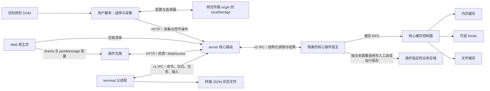

# SCWC 核心数据流与存储

> 核对日期：2026-10-18。依据当前源码描述已实现行为。
> 范围包括 `projects/server`、`projects/terminal`、`projects/user-script`、`projects/web`、`projects/shared` 和 `projects/webutils`。`projects/server/plugin/` 是核心扩展基础设施；`projects/server/plugins/` 内各插件的业务实现、私有接口和数据库不在本文范围内。

配套文档：[Server 核心接口](./Server核心接口.md)、[数据库](./数据库.md)、[终端与服务数据交互](./终端与服务数据交互.md)、[核心部署](./核心部署.md)。

## 1. 数据边界与总体流向

核心负责从网页生成采集载荷、路由到匹配插件、转发处理结果，并提供配置、缓存、页面承载和终端任务基础设施。采集接口本身没有自动归档、写入数据库或统一保存采集结果的步骤；是否保存及保存位置由处理插件决定。



这些通路有不同的持久化语义：浏览器配置和终端状态用于恢复用户环境，缓存可以淘汰，插件业务数据由插件负责。它们不能互相替代。

## 2. 网页采集链路

### 2.1 从选择器到采集载荷

用户脚本保存的是选择规则，运行时再读取当前 DOM：

```ts
// 浏览器中的规则 Item
{ selector: string, label: string, prefix: string }

// getCrawlData 的结果
{
  result: Array<{ label: string, value: string, images: string[] }>,
  failed: string[] // 未找到元素的选择器
}
```

1. `content-claw.ts` 维护选择器、标签、前缀和排序，并写入 localStorage。
2. `getCrawlData()` 查询每个选择器，遍历文本节点，将非空文本片段添加 `prefix` 后以空格拼接。
3. 收集选中元素本身及其内部的 `img`，按元素去重。优先通过 canvas 转为 PNG dataURL；转换异常时回退为原 `img.src`。因此 `images` 可以同时包含 dataURL 和 HTTP URL。
4. 找不到元素时把选择器写入 `failed`。图片转换失败不属于该列表。
5. 普通采集在存在失效选择器时不发送请求；控件触发是否允许部分采集由其 `requireFullContent` 选项决定。

规则不包含历史 DOM 快照；`value` 和 `images` 是发起采集时生成的数据。

### 2.2 从 HTTP 到隔离宿主

用户脚本向 `/api/metadata/scrape?site=...` 发送 `{ site, data }`，携带 Bearer token。服务端先执行来源检查、鉴权和 Zod 载荷校验，再根据解码后的正文 `site` 匹配已加载插件。

匹配插件按当前注册列表顺序逐个 `await onRequest()`，不是并行广播。核心通过 `PluginProcessClient` 将结构化参数传入独立进程，宿主构造工具与日志对象后执行插件回调。某个插件抛错会被记录，后续插件仍会执行；已经产生的副作用不会自动回滚。

插件发出的 `toWeb(info, type)` 通知经 IPC 回到核心，核心汇总为 HTTP 响应中的通知数组。`success: true` 表示至少一次匹配调用正常返回，不证明数据已经持久化，也不代表每条通知都是成功消息。完整请求及响应见 [Server 核心接口](./Server核心接口.md)。

### 2.3 控件链路

`GET /api/plugin/config` 返回匹配站点的控件描述，不传输 `trigger` 函数。核心把控件通道和关联通道转换为 `plugin:<name>:<id>:<channel>`。

用户操作后，脚本将当前采集结果、控件值和关联控件值发送到 `/api/plugin/toggle`。核心选择插件与控件，移除关联通道的外层命名空间，再通过宿主执行 `trigger`。控件状态在浏览器控制器内维护，重新加载列表时会重建；核心没有通用的控件值持久化表。

## 3. Web 页面与资源链路

1. `projects/web/src/main.ts` 先读取本机同源 `/web/local-config`，成功后用本次服务 token 和实际端口更新浏览器配置；失败保留已有配置。完成后才加载布局，避免首次清单请求使用旧 token。
2. 宿主页请求 `/web/api/pages`，用户选择后以 iframe 打开 `/web/page/plugin/:pluginDir`。
3. 核心校验插件 UI 真实路径边界，解析 HTML 并在 head 最前注入最新 scwcutils，引导早于应用脚本。
4. iframe 加载时，宿主页通过 `scwc-plugin-config` 消息传入连接配置。工具库请求 safeId，再建立该插件的 HTTP、资源 URL 和 WebSocket 工厂；独立打开页面时在 `load` 阶段从本地存储初始化。
5. 插件 API 通过 `/web/api/plugin/:safeId/...` 代理到宿主；WebSocket 的真实连接、连接集合和广播由核心持有，回调通过 IPC 转发。
6. 文件资源通过绝对文件路径描述符返回给核心，由 Express 直接传文件并处理 Range、背压。文件字节不经过插件 IPC。

`safeId` 是每次加载生成的临时路由标识，重载后会改变。卸载会移除路由并终止对应 WebSocket；浏览器需要重新获取 safeId 并重建连接。

当前宿主页只在 iframe `load` 时发送配置；设置变化不会主动再次推送。配置消息接收端没有校验 `event.origin`，宿主页发送时使用 `targetOrigin='*'`，并包含 token。这是当前边界，不能把消息通路描述成已进行来源验证。

## 4. 运行期状态与进程间传输

| 状态/通路 | 所有者 | 传输及保存方式 |
| --- | --- | --- |
| 已加载插件、safeId、命令与路由注册 | server 核心 | 进程内集合；启动/启用/禁用/重载时更新，不作为数据库保存 |
| 核心插件回调、内部对象 | 核心插件宿主 | v2 IPC 只传描述、参数和结果，函数留在宿主 |
| 日志、任务快照、取消与交互输入 | 核心/终端及各宿主 | 带调用身份的 IPC；实时任务在内存中，终端保存显示状态 |
| WebSocket 与 HTTP 响应对象 | server 核心 | 真实对象留在核心，宿主收到请求元数据和连接标识 |
| 命令补全缓存 | 核心命令注册或插件宿主 | 内存值与更新时间，无统一落盘和自动后台刷新 |

HTTP JSON 上限为 `100mb`，但核心插件 v2 IPC 单消息上限为 **16 MiB**；终端 v1 IPC 单消息上限为 **1 MiB**。HTTP 接收成功不保证能够继续跨进程传输。大文件应走资源描述符通路。

## 5. 持久化清单

### 5.1 浏览器 localStorage

| key | 内容 | 写入者 |
| --- | --- | --- |
| `__selective_crawl_items__` | `Item[]`：选择器、标签、前缀及顺序 | 用户脚本 `content-claw.ts` |
| `__selective_crawl_config__` | `api.host/port/token`、`plugin.refreshRule`、`notify.placement` | 共享 `ConfigController`；Web 启动配置加载 |
| `scw-persistent-data` | `version: '2.0.0-1'`、窗口位置/最小化、插件面板展开与活动标签 | 用户脚本 `root.ts` |

localStorage 按 **origin（协议、主机、端口）** 隔离。目标网站里的用户脚本和本机 Web 页面不会因为 key 相同就自动共享配置；更换服务端口也会进入不同的存储空间。这里不是油猴的 GM 存储，也不会由核心集中备份。

`loadFromStorage()` 按模板补齐数据、丢弃模板外字段，并将修复结果写回；读取或解析失败会写入回退值。因此它不是只读加载器，也不是严格的 schema 验证器。共享配置通过其他同源页面的 `storage` 事件同步；`setConfig()` 本身只更新当前实例并保存，不会自动同步同页所有实例。

旧版 `scw-floating-pos`、`scw-floating-minimized`、`scw-floating-plugin-expanded` 由 `updateLocalStorage.ts` 迁移到统一记录；迁移成功后删除旧 key。

### 5.2 服务配置与插件启用状态

服务读取 `ENV_DIR/.env`，文件中提供的键优先于进程环境；不是任意当前工作目录的 `.env`。引导进程管理的 `SCWC_APP_DIR`、`SCWC_RUNTIME_ROOT`、`SCWC_DISTRIBUTION_MODE` 不允许被 `.env` 覆盖。

核心插件启禁状态存储在对应插件 `package.json` 的 `enabled` 字段中，不在终端状态文件中。写入采用临时文件、原文比对和 rename；启用成功后保存 `true`，保存失败回滚本次激活；禁用先保存 `false` 再停止插件。重载保留启用状态并换新 safeId。

### 5.3 内存、Redis 和文件缓存

`utils/cache.ts` 使用 cache-manager 组织内存 Keyv 与可选 Redis：

- 内存适配器配置 `lruSize: 5000` 和默认 `ttl: 60000`；上层 cache-manager 配置默认 TTL 为 `3600000` 毫秒、`refreshThreshold: 1800000` 毫秒。两层配置不能概括成“所有内存项固定存活一分钟”。
- `REDIS_ENABLED` 默认开启；设为 `false` 或 `0` 后不创建 Redis 客户端，继续使用内存与文件缓存。连接参数见 [数据库](./数据库.md)。
- 核心为插件绑定命名空间 `plugin:<目录名>`。逻辑键形如 `plugin:<目录名>:<key>`；Redis 再使用配置的实例前缀。目录名决定缓存隔离，safeId 不参与缓存键。
- 小值直接写缓存；超过 **5 MiB** 的值及核心直接使用的 `Readable` 写入 `ROOT/cache/files/<uuid>`，缓存仅记录类型和路径。独立插件进程的缓存 RPC 不支持流。
- 重定向缓存必须指向已存在的目标，写入检查环并指向最终键；读取继续检查环和目标是否存在。
- `del`、`mdel` 和键过期不会同步删除溢出文件。缓存元数据丢失或文件缺失都会导致无法读取，单独保留文件不能恢复完整缓存。

普通核心退出调用 `clearAll()` 清理文件目录和缓存存储；重启跳过这一步。但内存随核心进程退出消失，只有仍有效的 Redis 元数据与文件可能继续复用。禁用 Redis 时，重启保留的文件没有可恢复的内存索引，不能视为持久缓存。

缓存控制器向插件只暴露其命名空间的 `set/get/setRedirect/del/mdel`，不暴露 `clearAll`。核心内部的 `clearAll(logger, namespace)` 当前即使传入 namespace 也会清空全部核心缓存。不同实例应使用独立 Redis 前缀，不能依靠插件命名空间区分实例。

### 5.4 采集结果写入工具

核心提供 `writeData(dirPath, data)` 和 `writeDataURL(dataUrl, pathOrFactory)`，只有调用时才产生业务文件：

```text
调用者指定目录/
├── data.json        根数组，每次调用追加一个元素
└── images/          处理采集项图片时生成的文件
```

`writeData()` 创建目录和 `images/`；传入采集项数组时，图片保存后将 `images` 替换为文件路径，再将整批数组作为 `data.json` 的一个元素保存。普通 JSON 数据也以单个元素追加。成功返回 `{ data: 最新一项 }`，常规失败返回 `false`。

这里的追加通过“读全文件 → 内存修改 → 覆写全文件”实现，没有并发锁、事务或原子替换；多调用可能覆盖彼此的数据，图片先写后 JSON 写入失败也不会回滚。已存在的空 `data.json` 会解析失败。不要将其描述为可并发写入的数据库。

`writeDataURL()` 本身不创建目标目录。文件默认使用 UTC 时间前缀加 UUID；网络图片统一使用 `.png` 后缀，未检测或转换真实格式，dataURL 则从 MIME 子类型取后缀。

### 5.5 终端状态

默认路径为 `ENV_DIR/data/terminal/state.json`，可通过 `SCWC_TERMINAL_STATE_FILE` 修改；相对路径按 `ENV_DIR` 解析。`SCWC_TERMINAL_PERSIST=false` 禁用保存和状态锁。

终端在 dirty 时每秒保存，并在退出清理时再次保存。文件包含窗口、输出、命令历史、草稿、光标、滚动/回显锚点、插件冲突偏好和背景偏好；临时输入对象、恢复提示边界和全局底栏运行状态不保存。

保存和恢复使用串行写队列、临时文件、rename、`.bak` 备份及 PID/token `.lock`；损坏文件保留 `.corrupt-<时间戳>` 副本。恢复最多 128 个窗口，每窗最多 10000 行/10 MiB 输出、1000 条历史。恢复不会重新执行任务，上次运行中的任务被标记中断。详细字段及交互见 [终端与服务数据交互](./终端与服务数据交互.md)。

## 6. 路径与运维含义

| 路径概念 | 源码运行 | 内置 Node 发行版 | 外置 Node 发行版 |
| --- | --- | --- | --- |
| `ROOT` / `ENV_DIR` | 仓库根 | 可执行文件所在部署目录 | 引导指定的部署目录 |
| `SERVER_ROOT` | `projects/server` | 释放到临时目录的运行资源 | 部署包 `runtime` 资源目录 |
| 缓存与默认终端状态 | `ROOT/cache`、`ROOT/data/terminal` | 部署目录下 | 部署目录下 |

备份应区分不可替代的数据与可重建缓存：浏览器存储在浏览器侧；终端状态及插件启用配置在磁盘；插件业务输出另按插件配置备份。构建产物和 SEA 临时运行资源不承担业务持久化职责。不要把核心正常退出后会清理的缓存当作唯一数据副本。

## 7. 源码定位

| 主题 | 主要证据 |
| --- | --- |
| 采集与发送 | [claw.ts](../projects/user-script/src/utils/claw.ts)、[content-claw.ts](../projects/user-script/src/layouts/content-claw.ts)、[crawl.ts](../projects/user-script/src/api/crawl.ts) |
| 核心路由与控件 | [router/index.ts](../projects/server/router/index.ts)、[router/plugin.ts](../projects/server/router/plugin.ts) |
| 隔离调用与资源传输 | [client.ts](../projects/server/plugin/process/client.ts)、[host.ts](../projects/server/plugin/process/host.ts)、[resource.ts](../projects/server/plugin/process/resource.ts) |
| 浏览器配置与页面通信 | [config.ts](../projects/shared/store/config.ts)、[storage.ts](../projects/shared/utils/storage.ts)、[content.ts](../projects/web/src/layouts/content.ts)、[工具库入口](../projects/webutils/lib/index.ts) |
| 服务存储及退出 | [cache.ts](../projects/server/utils/cache.ts)、[writeData.ts](../projects/server/utils/writeData.ts)、[load.ts](../projects/server/plugin/load.ts)、[server/index.ts](../projects/server/index.ts) |
| 路径及终端存储 | [paths.ts](../projects/server/common/paths.ts)、[terminal/index.ts](../projects/terminal/index.ts)、[terminal/storage.ts](../projects/terminal/storage.ts) |


## Web 工作台后端持久化（2026-10-18）

新增[工作台后端](Web后端接口.md)及独立 workbench.sqlite；插件 onLoad 的 context.config 和 Web 配置 API 共用运行时 data/scwc/plugin-config.sqlite。值仅字符串，插件自行格式化；不使用 Redis，不读 CLI 状态，不随插件停止清理。工作区和插件关闭历史原子写；配置按插件 revision CAS；输出提交后推事件。grant、租约、WS票据、在线输入仅在内存。表结构和恢复见[数据库](数据库.md)。
