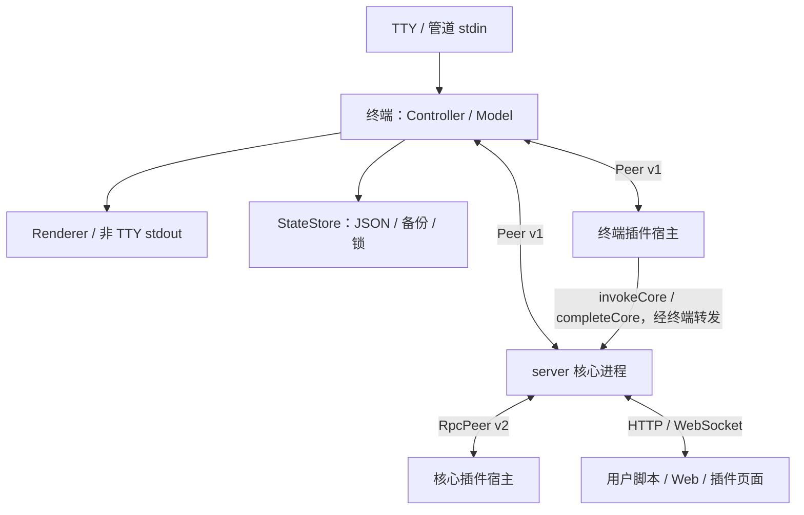
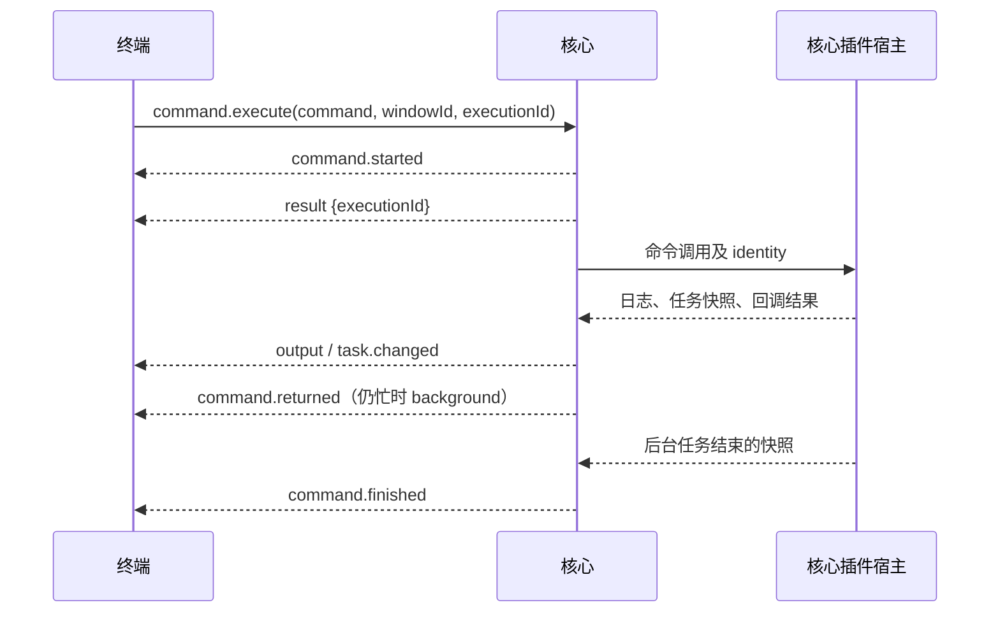

# SCWC 终端与服务数据交互

> 核对日期：2026-10-18。描述 `projects/terminal` 与它启动的核心服务、终端插件宿主，以及核心插件宿主之间的现有数据契约。
> 不包含 `projects/server/plugins/` 内各插件的私有接口。HTTP 接口见 [Server 核心接口](./Server核心接口.md)，存储全貌见 [核心数据流与存储](./核心数据流与存储.md)。

## 1. 进程拓扑与职责

终端是父进程，持有窗口、输入、输出缓冲、渲染与状态文件；server 核心是其子进程，持有 HTTP 服务、核心命令注册表、核心插件生命周期及缓存。两者通过 Node `fork` 的 IPC 通信，终端不通过 HTTP 执行命令，也不共享服务端内存。



核心和终端插件宿主不是同一种进程：终端插件注册终端命令，核心插件提供采集、浏览器控件和 Web 能力。它们的插件契约与 IPC 版本分别管理。

| 边界 | 核心实现 | 协议 |
| --- | --- | --- |
| 终端 ↔ server | `terminal/core.ts`、`server/command/ipc.ts` | `terminal/peer.ts` 的 v1 |
| 终端 ↔ 终端插件宿主 | `terminal/plugin/load.ts`、`terminal/plugin/host.ts` | 同一 Peer v1；终端插件 `apiVersion: 1` |
| server ↔ 核心插件宿主 | `server/plugin/process/client.ts`、`host.ts` | `RpcPeer` v2；核心插件 `apiVersion: 2` |

## 2. 启动、握手与命令发现

1. `startTerminal()` 读取环境、获取状态锁并恢复窗口；默认使用 `ENV_DIR/data/terminal/state.json`。
2. `CoreConnection.start()` fork 核心入口，追加 `--no-terminal --interaction=ipc`，避免核心再次启动终端。子进程 stdin 为 ignore，stdout/stderr 为 pipe，另外保留 IPC，使用 `serialization: 'advanced'`。
3. 核心创建随机 `sessionId`，等待终端 `hello({ outputWindowId })`；握手等待上限为 15 秒。核心将公共输出窗口和会话绑定到调用身份。
4. 若命令行覆盖了环境中的插件目录，核心可发送 `confirmation.request`，由终端显示并通过 `confirmation.answer` 回答。
5. 核心注册默认命令、开始监听、异步加载插件，然后发送 `ready({ port, commands })`。**ready 不表示全部核心插件已经加载完成**；后续注册变化通过 `commands` 事件推送。
6. 终端随后加载自己的终端插件并裁决命令冲突；管道输入在核心与终端插件加载流程就绪后消费，配置确认可在此之前消费。

终端等待核心 ready 的启动计时为 45 秒；收到配置确认请求后暂停计时，提交答案后重新开始该计时。源码和发行版选择不同入口文件，交互协议保持相同。

## 3. v1 消息信封与身份

`terminal/protocol.ts` 定义三类消息：

```ts
type Packet =
  | { version: 1; sessionId: string; kind: 'call'; id: string; method: string; args: unknown }
  | { version: 1; sessionId: string; kind: 'result'; id: string; value?: unknown; error?: string }
  | { version: 1; sessionId: string; kind: 'event'; event: string; data: unknown };
```

`call` 的响应按 `id` 对应；`result.error` 是错误字符串，没有 HTTP 状态或 HTTP 响应包装。事件用于命令进度、日志和输入等推送，不需要逐条 RPC 应答。

| 身份 | 作用与生命周期 |
| --- | --- |
| `sessionId` | 核心每次启动生成；hello 的首次结果建立会话，后续拒绝旧会话结果和事件 |
| RPC `id` | Peer 为每次 call 生成，用来关联该次请求和结果 |
| `windowId` | 窗口 UUID；显示编号 `cmd1` 等可以复用，UUID 不复用 |
| `executionId` | 一次执行的身份，贯穿日志、任务、输入和取消 |
| `parentExecutionId` | 终端插件调用核心子命令时建立父子关系 |
| 补全请求 `args.id` | 用于补全取消的业务请求身份，区别于 RPC 信封 id |
| `owner` | 任务所属核心或插件宿主，强停和宿主移除时使用 |

核心的 session 握手保证不能推导为所有 v1 通路都生成新 session：当前终端插件宿主复用 Peer，但两端未显式设置 sessionId，使用默认空值；其连接与生命周期由对应的子进程对象隔离。

## 4. 终端 → 核心 RPC

| method | args | 返回与含义 |
| --- | --- | --- |
| `hello` | `{ outputWindowId }` | `{ sessionId }`，建立公共输出身份并解除握手等待 |
| `confirmation.answer` | `{ id, answer: boolean }` | 无业务返回；完成对应配置确认 |
| `command.validate` | `{ command }` | `{ name, pluginId }`；解析并校验当前命令，不执行回调 |
| `command.complete` | `{ command, cursor, id?, windowId? }` | `CompletionResult`；只查询候选 |
| `command.execute` | `{ command, windowId, executionId, parentExecutionId? }` | 普通命令返回 `{ executionId }`；退出/重启请求可返回 `{ control: true }` |
| `command.cancel` | `{ executionId?, force? }` | `{ cancelled: true }` 或 `{ cancelled: false, needsForce: true, owners }`；force 后也可能返回 `{ cancelled: false }` |
| `tasks.snapshot` | 无 | 当前 `TaskSnapshot[]` |
| `input.answer` | `{ id, value: string }` 或 `{ id, error: 'eof'/'cancelled'/'busy' }` | 无业务返回；输入已结束时拒绝 |
| `lifecycle.exit` | `{ force? }` | 成功返回 `{ stopping: true }`，未能取消任务则返回取消结果 |
| `lifecycle.restart` | `{ force? }` | 同上；核心按重启语义卸载，终端负责拉起新核心 |

核心拒绝同一窗口同时运行多个顶层命令；子命令可以携带父执行身份。`executionId` 必须非空且不能重复使用。

退出和重启由终端协调：核心收到顶层 `exit/restart` 命令时发出 `lifecycle.request`，不是在命令回调中立即关闭父进程。子命令禁止执行退出/重启，终端和核心两侧均检查这一限制。

## 5. 核心 → 终端事件

| event | data | 终端如何使用 |
| --- | --- | --- |
| `ready` | `{ port, commands: CommandInfo[] }` | 标记核心就绪，展示实际端口并更新命令清单 |
| `commands` | `CommandInfo[]` | 注册表变化时更新清单、取消旧补全并重新检查终端插件命令冲突 |
| `output` | `OutputEvent` | 按窗口/执行身份写入显示缓冲 |
| `task.changed` | `TaskSnapshot[]` | 更新活动任务状态 |
| `command.started` | `ExecutionEvent` | 记录执行开始 |
| `command.returned` | `ExecutionEvent` | 命令函数返回；可能仍为 background |
| `command.finished` | `ExecutionEvent` | 命令函数已返回且相关任务不再忙碌，结束本次执行 |
| `input.request` | `InputRequest` | 在所属命令窗口或全局交互面板等待输入 |
| `input.closed` | `{ id, windowId }` | 只清除匹配的临时输入 |
| `confirmation.request` | `{ id, text }` | 显示配置确认并等待布尔答案 |
| `lifecycle.request` | `{ restart: boolean }` | 进入终端统一退出/重启流程 |
| `stopping` | `{ restart: boolean }` | 核心已进入停止阶段的通知 |

`CommandInfo` 包含 `name`、可选 `description/subCommands/system/scope/usage`。首词候选来自当前清单，参数候选才请求对应服务。

`CoreConnection` 还在终端进程内产生 `closed`、`failure` 事件，它们是子进程状态回调，不是 IPC 协议事件。

## 6. 命令返回与任务结束



图中展示语义阶段；RPC result 和事件使用不同发送路径，客户端不能依赖每条消息与示例完全相同的到达次序。应以 executionId 关联，以 finished 判定执行结束。

`ExecutionEvent`：

```ts
{
  executionId: string;
  windowId: string;
  command: string;
  status: 'running' | 'background' | 'cancelling' | 'succeeded'
        | 'failed' | 'cancelled' | 'interrupted';
  error?: string;
}
```

任务以三种占用维度计算 busy：自动调用计数 `automatic > 0`、`setBusy(true)` 的 `manual`，以及 `tasks.begin()` 尚未结束的句柄数 `reported`。回调返回会结束自动调用，但不会替调用者清理手工 busy 或 begin 句柄。

快照包含 `id/owner/identity/automatic/manual/reported/returned/revision/busy/label`。跨进程更新要求 revision 递增；移除的宿主不接受迟到快照。宿主强停、核心异常退出等属于 `interrupted`，不能显示为正常完成。

## 7. 日志路由

`OutputEvent` 为 `{ windowId: string | null, executionId?, text, pluginId?, level? }`，level 为 `info/pathInfo/warn/error`。

核心通过日志 sink 将结构化日志发到终端；绑定日志对象保留原调用身份，异步晚到日志仍可归属原窗口。插件 console 和原始 stdout/stderr 也被桥接；原始 stdio 无法确定唯一活动调用时进入公共输出。核心子进程未结构化的 stdout/stderr 由 `CoreConnection` 直接送公共输出窗口。

终端优先按 windowId 查找窗口。窗口已关闭的输出进入公共窗口，附原窗口/执行标识，不会进入恰好复用了显示编号的新窗口。全局交互输出可显示在临时底栏；已丢弃的全局执行迟到输出会被控制器忽略。

## 8. 交互输入

`InputRequest` 为：

```ts
{
  id: string;
  identity: { executionId: string, windowId: string | null, sessionId?: string,
              parentExecutionId?: string };
  message: string;
  type: 'string' | 'number' | 'boolean' | 'bigint' | 'date';
}
```

核心插件调用 `next()` 时，宿主先通过 `input.next` 请求核心；核心发送 `input.request` 给终端。终端回复原始字符串，服务侧执行类型转换，格式错误会用新的输入请求重新提示。String 保留空白，Number 必须是非空有限数，Boolean 接受 true/false、yes/no、y/n、1/0，BigInt 使用整数字符串，Date 必须能解析为有效日期。

`next()` 返回 `[error, undefined]` 或 `[undefined, value]`，错误 code 为 `cancelled/closed/unavailable/busy/invalid-type`。同一调用只能同时等待一个输入。输入没有墙钟超时，跨宿主使用 `timeout=0`，取消通过独立 `input.cancel` 事件传递。

终端用户取消输入发送 `cancelled`，管道 EOF 发送 `eof`，同窗口已有其他输入时发送 `busy`。取消输入不等于取消整个命令；命令回调根据错误结果决定下一步。EOF 只关闭交互输入，服务不会因此自动退出。

配置确认是独立的 `confirmation.*` 通路，答案为布尔值，不能与 `input.answer` 混用。

## 9. 补全与取消

```ts
// 偏移使用 UTF-16；command 不含全局输入提示符 ':'
type CompletionRequest = { command: string, cursor: number, id?: string, windowId?: string };
type CompletionResult = {
  command?: string; // 回显被查询的原文；兼容旧回调时可省略
  inline?: boolean;
  from: number;
  to: number;
  items: Array<{ name: string, insertText: string, description?: string }>;
};
```

浅层参数查询有 60ms 防抖；深层参数通过 400ms 内双 Tab 触发。服务返回当前层候选，终端负责筛选与预览。多行显式续行先合并成执行/补全文本，再把替换范围映射回编辑原文。插件命令冲突添加前缀时，终端插件加载器还会还原宿主命令名并回映结果偏移。

补全 RPC 使用 `timeout=0` 和 AbortSignal。输入变化、切换窗口、清单变化、执行或断连使旧请求失效；终端发 `completion.cancel({ id })` 取消对应服务请求，并核对输入版本/原文后才应用结果。只拒绝本地 Promise 不足以取消远端候选工作。

补全不执行命令，也不注册业务任务；回调日志和原始 stdio 归公共输出，避免占用或污染命令窗口。命令补全缓存保存在对应注册或宿主内，包含更新时间，没有统一持久化。

## 10. 终端插件宿主的双向桥接

每个终端插件运行在独立宿主中，向终端返回命令描述；执行函数、补全函数保留在宿主。冲突裁决完成前不向用户发布命令。内建 `scwc` 适配把核心系统命令接入全局扩展，但不注册 exit/restart，它们走统一生命周期逻辑。

| 方向 | 方法/事件 | 内容 |
| --- | --- | --- |
| 终端 → 宿主 call | `hello` | `{ entry?, pluginId, outputId, commands }`；返回 `{ identifier?, commands }` |
| 终端 → 宿主 call | `identifier.set` | 更新裁决后的插件短标识 |
| 终端 → 宿主 call | `execute` | `{ name, args: string[], identity }` |
| 终端 → 宿主 call | `complete` | `{ name, request: CompletionRequest }`，无期限等待，可取消 |
| 终端 → 宿主 call | `cancel` / `unload` | 按 executionId 取消，或取消全部并执行卸载 |
| 终端 → 宿主 event | `completion.cancel` | `{ id }`，取消候选查询 |
| 宿主 → 终端 call | `invokeCore` | `{ command, identity }`；终端新建核心子执行并设置 parentExecutionId，等待核心 finished 后才完成 |
| 宿主 → 终端 call | `completeCore` | 带请求 id 的核心候选查询，经终端转发 |
| 宿主 → 终端 call | `input.next` | 输入请求，返回 `{ value }` 或 `{ error: { code, message } }` |
| 宿主 → 终端 event | `output` / `task` | 带身份输出，或单条任务快照 |
| 宿主 → 终端 event | `input.cancel` / `completeCore.cancel` | 按 id 取消输入或下游补全 |

`invokeCore` 会在父调用中保留一个任务句柄，直到核心子命令完成。父命令不能因为转发 RPC 已受理就提前结束。终端插件执行及 invokeCore 桥接当前使用 24 小时 RPC 期限；它们与无期限的输入、补全不同。

核心插件宿主另用 v2 信封（没有 v1 顶层 sessionId），通过 initialize、命令/采集/控件/API/资源调用及日志、通知、任务事件与核心通信。真实文件和 socket 留在核心，函数和业务内部状态留在宿主；这是传输与隔离边界，不代表终端拥有具体插件业务接口。

## 11. 取消、退出、重启与故障

`command.cancel` 沿执行及其子执行关系向 taskRegistry 和核心插件宿主发送取消，先等待约 2 秒协作结束。仍有任务时返回 `needsForce/owners`。force 会终止相关插件宿主，可能中断同一宿主内的其他任务；终端插件也执行类似的协作取消和按 owner 强停。

退出或重启时，终端查询任务快照，必要时请求用户确认，再协调两类任务取消。核心成功进入停止阶段后先返回 RPC，再异步执行 shutdown。shutdown 等待初始插件加载及管理队列、卸载插件；普通退出清缓存，重启保留缓存。终端等待旧核心关闭后再启动新核心，并重新握手建立新 session。

若强制停止核心，正常 shutdown 和缓存清理可能未执行。父终端断开时核心会清理输入并执行退出；插件宿主父 IPC 断开时会终止自身进程树。

核心意外关闭后，终端将相关执行标记为 interrupted，并对连续启动失败最多重试 3 次，使用指数退避；用户也可使用 `:r` 重试。不会自动重放原业务命令。

## 12. 容量、顺序与超时

| 项目 | v1 Peer / 当前实现 |
| --- | --- |
| 单消息大小 | V8 序列化后不超过 1 MiB |
| 待响应请求 / 同时接收处理 | 各最多 64 |
| 并行发送 | 最多 128 |
| 事件队列 | 最多 32 MiB 或 16384 条 |
| 普通 RPC 默认超时 | 10 秒；输入/补全显式使用 0 表示无期限 |
| 断连 | 清空事件队列并拒绝所有本地 pending 请求 |

事件队列按序发送，防止 `command.finished` 越过此前排队输出。输出过载会产生带原归属的 `output.overflow` 标记，Peer 接收端将其映射为普通 output；其他关键事件超过队列预算会关闭通信。不能将这种有界队列视为无限日志存储。

核心插件 v2 单消息上限为 16 MiB，请求上限 64、并行发送 128，同样有 32 MiB/16384 条事件队列。RPC 超时或本地 AbortSignal 只结束相应请求等待，不自动终止业务；业务取消须经过专用事件/方法。

## 13. 终端状态持久化与恢复

状态文件由终端拥有，server 不直接读写：

```ts
{
  version: 1,
  activeId,
  globalDraft,
  globalHistory,
  pluginPreferences,
  transparentBackground,
  windows: [/* 输出窗口、命令窗口及其显示/编辑状态 */]
}
```

窗口字段包括 UUID/类型/编号/标题、输出 lines/bytes/lineOffset、命令回显位置 commandLines、草稿/光标、历史及编辑锁、滚动锚点，以及保存时可能存在的任务显示状态。保存移除临时 `input` 与 `restoredHistoryEnd`；全局底栏执行/输入面板不存档。

dirty 状态每秒串行保存一次，退出再次保存；先写 token 临时文件，再备份健康主文件并 rename。`.lock` 以排他创建记录 PID/token，仅确认 PID 已不存在才回收旧锁，释放时核对 token。主文件不可用时尝试 `.bak`，损坏主文件另存副本，不把坏文件覆盖成健康备份。

恢复校验格式并限制窗口最多 128 个、每窗输出最多 10000 行/10 MiB、历史最多 1000 条、草稿最多 65536 字符。上次 running/background/cancelling 的执行只追加中断提示，**不会恢复 RPC、输入等待或重新执行命令**。恢复分界提示临时计算，不写回历史输出。

`pluginPreferences` 保存插件冲突策略和自定义标识，不保存插件启禁状态；核心启禁状态由插件 package.json 管理。`SCWC_TERMINAL_PERSIST=false` 关闭终端状态持久化；相对 `SCWC_TERMINAL_STATE_FILE` 路径相对 `ENV_DIR` 解析。

## 14. 源码与现有验证入口

| 关注点 | 源码 | 现有测试 |
| --- | --- | --- |
| 信封、会话、队列 | [protocol.ts](../projects/terminal/protocol.ts)、[peer.ts](../projects/terminal/peer.ts) | [peer.test.ts](../projects/terminal/peer.test.ts) |
| 启动与核心桥接 | [core.ts](../projects/terminal/core.ts)、[ipc.ts](../projects/server/command/ipc.ts)、[server/index.ts](../projects/server/index.ts) | [controller.test.ts](../projects/terminal/controller.test.ts) |
| 任务与输入 | [tasks.ts](../projects/server/common/tasks.ts)、[interaction.ts](../projects/server/common/interaction.ts) | [tasks.test.ts](../projects/server/common/tasks.test.ts)、[interaction.test.ts](../projects/server/common/interaction.test.ts) |
| 补全与多行映射 | [controller.ts](../projects/terminal/controller.ts)、[command-text.ts](../projects/terminal/command-text.ts) | [completion.test.ts](../projects/terminal/completion.test.ts)、[multiline.test.ts](../projects/terminal/multiline.test.ts) |
| 终端插件桥接 | [load.ts](../projects/terminal/plugin/load.ts)、[host.ts](../projects/terminal/plugin/host.ts) | [global.test.ts](../projects/terminal/plugin/global.test.ts)、[conflicts.test.ts](../projects/terminal/plugin/conflicts.test.ts) |
| 文件状态与恢复 | [storage.ts](../projects/terminal/storage.ts)、[index.ts](../projects/terminal/index.ts) | [storage.test.ts](../projects/terminal/storage.test.ts) |

这些是后续修改协议时的验证入口；本文的源码核对不表示已经执行上述测试或验证了当前运行实例。
